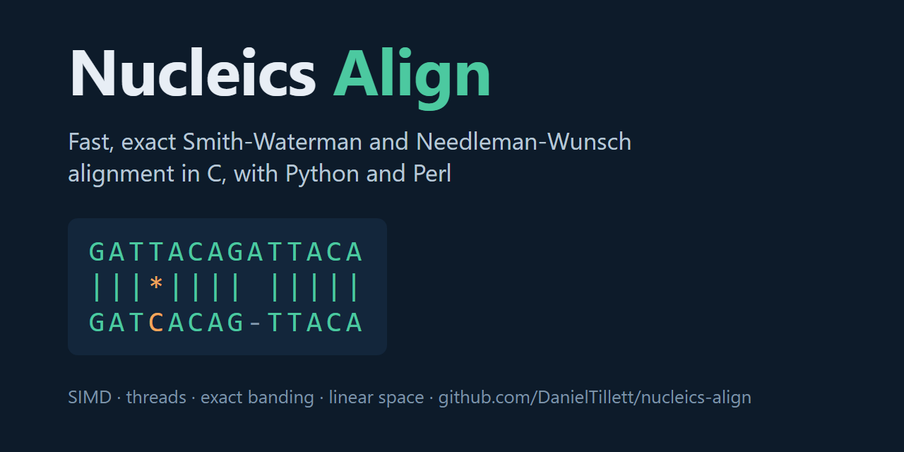
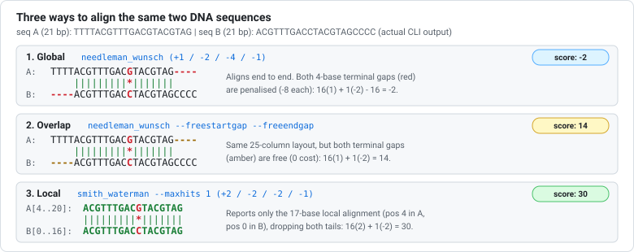
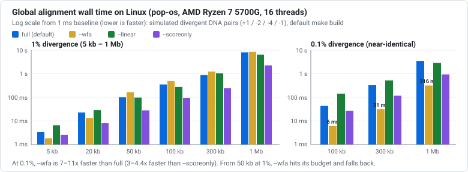

<p align="center">
  
</p>

# Nucleics Align

**Fast, exact pairwise sequence alignment in C**: optimal local (Smith-Waterman) and global (Needleman-Wunsch) alignment with affine gaps, from the command line, Python, Perl or C.

[](https://github.com/DanielTillett/nucleics-align/actions/workflows/ci.yml)
[](LICENSE)


## Why I built this

I started from Isaac Turner's [seq-align](https://github.com/noporpoise/seq-align), which I have always liked for one simple reason: it is straightforward, exact, and gives you the real Needleman-Wunsch or Smith-Waterman alignment without heuristics getting in the way. The catch was speed and memory. Aligning a 20 kb DNA pair took 10 seconds and 4.6 GB of RAM; at 50 kb it would have needed ~30 GB, so it could not be run on a typical desktop.

Nucleics Align keeps the same mathematics and tie-breaking rules, and adds striped SIMD fills, multi-threading, exact banding, difference-encoded lanes, a linear-space global aligner (Hirschberg / Myers-Miller), Myers' bit-vector edit distance, and wavefront alignment (`--wfa`). The rule throughout has been simple: **every default speed-up must produce the same alignment as the plain dynamic programming it replaces** (see [CHANGELOG.md](CHANGELOG.md) for the few intentional bug fixes).

**When to use it:** When you want an exact, reproducible affine-gap alignment of sequence pairs, from short PCR primers up to megabase sequences.

**When to use something else:** If you are mapping millions of reads to a reference genome, use a seed-and-extend mapper like `minimap2`. If you only ever need unit-cost Levenshtein edit distance, `edlib` is built for that.

<p align="center">
  
</p>

## Quick start

```console
$ git clone https://github.com/DanielTillett/nucleics-align
$ cd nucleics-align
$ make
$ ./bin/needleman_wunsch --printscores --pretty GATTACAGATTACA GATCACAGTTACA
GATTACAGATTACA
|||*|||| |||||
GATCACAG-TTACA
score: 5
```

In `--pretty` output, `|` is a match, `*` is a mismatch, and a space is a gap.

## Which mode should I pick?

Here is the checklist I use myself:

| What you have | Command | Why |
|---|---|---|
| Everyday global alignment | `./bin/needleman_wunsch --printscores seqA seqB` | Exact, banded, multi-threaded, fixed tie-breaking |
| Near-identical pairs (~0.1%–1% divergence up to 1 Mb) | `./bin/needleman_wunsch --wfa --printscores --file pairs.fa` | $O(s)$-space BiWFA with 32-byte AVX2 match extension (~92 ms / 12 MiB at 1 Mb 0.1%); raise its diagonal-update cap with `--wfabudget <n>` for longer 1% pairs |
| Long or divergent pairs (50 kb – 1 Mb+) | `./bin/needleman_wunsch --linear --printscores --file pairs.fa` | Keeps RAM at most 46–110 MiB even at 1 Mb and 5% divergence; uses Myers bit-vector split rows on 1-thread unit-cost pairs |
| Mixed batch of short and long pairs | `./bin/needleman_wunsch --linearabove 100000 --printscores --file pairs.fa` | Exact matrices for short pairs, linear memory for long ones |
| Just the score | `./bin/needleman_wunsch --scoreonly --file pairs.fa` | Fastest for scores alone (linear memory); uses Ukkonen-banded Myers bit-vector under unit costs (`0/-1/0/-1`), with multi-threaded striped SIMD fallback on divergent pairs |
| Best local hit | `./bin/smith_waterman --maxhits 1 --file pairs.fa.gz` | Skips indexing sub-optimal hits; 20 kb best hit uses 3–25 MB instead of gigabytes (add opt-in `--fastlocal` for ~4 MiB verified BiWFA/linear reconstruction) |
| Protein alignment | `./bin/needleman_wunsch --scoring BLOSUM62 seqA seqB` | Built-in PAM30, PAM70, BLOSUM80, BLOSUM62 |
| Overlap alignment | `./bin/needleman_wunsch --freestartgap --freeendgap seqA seqB` | Free overhangs at both ends |
| Repeated substrings in one sequence | `./bin/lcs ACGTACGTTACGACGT` | Lists common substrings longest first |

> [!NOTE]
> `--linear`, `--linearfallback`, `--linearabove`, `--wfa` and `--fastlocal` always return the same optimal score as the default aligner, but when several alignments tie for the best score they may pick a different one.

## Building

Nucleics Align builds on Linux, macOS, and Windows under WSL (native Windows compilers are not supported). You need a C11 compiler (`gcc` or `clang`), `make`, `zlib` (`zlib1g-dev` on Debian/Ubuntu; built into macOS), and a C++ compiler if you want the C++ examples.

| Command | What it does |
|---|---|
| `make` | Builds the tools in `bin/`, the static library `src/libalign.a`, and the examples |
| `make bin/needleman_wunsch bin/smith_waterman bin/lcs` | Builds just the CLI tools (no C++ compiler needed) |
| `make test` | Runs the C unit tests and the CLI fixtures |
| `make SANITIZE=1 test` | Same, under AddressSanitizer and UndefinedBehaviorSanitizer |
| `make NATIVE=1` | Tunes for your CPU (`-march=native`, enabling AVX-512 where present) |
| `make DEBUG=1` | Unoptimised build with debug symbols |

There is no `make install`: run the binaries straight from `bin/` or copy them onto your `PATH`.

> [!TIP]
> On x86-64 Linux, a plain `make` already builds AVX2, SSE4.1 and SSE2 versions into one portable binary and picks the best one at startup. You only need `NATIVE=1` if you want AVX-512 on your own machine.

To update an existing checkout:

```console
$ git pull
$ make
```

<details>
<summary>Platform &amp; dependency details</summary>

On x86-64 Linux the SIMD kernels use GCC/clang function multi-versioning (`target_clones` for `avx2`, `sse4.1`, `default`). GCC builds use 8-lane vectors across all three versions; clang uses 4-lane vectors when multi-versioning. `NATIVE=1` enables 16-lane AVX-512 where available. On Arm64 (including Apple silicon), NEON is used automatically.

The library depends on nothing but pthreads; the command line tools also need zlib (for `.gz` input). Since v2.0 nothing is bundled: the `libs/` submodules of earlier versions are gone.

</details>

## Performance at a glance

Global alignment wall time on a desktop 8-core Linux machine (AMD Ryzen 7 5700G, 8 default threads, default `make` build):

<p align="center">
  
</p>

Compared against other exact aligners on 20 kb simulated DNA (AMD Ryzen AI Max+ 395, wall time best of 3; every tool returned the same optimal score):

| Tool | 1% divergence | 10% divergence | Unrelated | Peak memory |
|---|---|---|---|---|
| seq-align (original) | 9.55 s | 9.75 s | 10.56 s | 4.6 GB |
| **Nucleics Align (default)** | **0.01 s** | 0.06 s | 0.06 s | 11 – 386 MB |
| **Nucleics Align `--linear`** | 0.02 s | **0.04 s** | **0.04 s** | **2 MB** |
| parasail | 1.17 s | 1.28 s | 0.76 s | 1.5 GB |
| ksw2 | 0.33 s | 0.35 s | 0.34 s | 524 MB |
| WFA2 | 0.01 s | 0.90 s | 23.3 s | 23 MB – 16.9 GB |
| WFA2 BiWFA | 0.01 s | 0.54 s | 10.3 s | 8 – 24 MB |

Nucleics Align used up to 16 threads while the other tools ran on one; even on a single thread (`--threads 1`), Nucleics Align takes 0.11–0.19 s against ksw2's 0.34–0.35 s. See [docs/performance.md](docs/performance.md) for the full tables (up to 1 Mb) and how each optimisation works.

## Python

[`python/nucleics_align.py`](python/nucleics_align.py) wraps the compiled tools using only the Python 3.7+ standard library. Passing an iterable of pairs sends them through a single tool run in parallel and yields results in input order.

```python
import sys
sys.path.insert(0, "python")
from nucleics_align import NeedlemanWunsch, SmithWaterman

nw = NeedlemanWunsch(gap_open=-5, threads=4)
aln = nw.align("ACGTTGCA", "ACGTGCA")
print(aln.align_a, aln.markers, aln.align_b, aln.score, sep="\n")

pairs = [("ACGT", "AGT"), ("GATTACA", "GCATGCA")]
for aln in nw.align_pairs(pairs):
    print(aln.score)
print(list(nw.score_pairs(pairs)))          # scores only, linear memory

for hit in SmithWaterman(max_hits=3).align("ttacgtacgtaa", "acgtacgt"):
    print(hit.score, hit.pos_a, hit.align_a, hit.align_b)
```

| Keywords | Tool options |
|---|---|
| `match`, `mismatch`, `gap_open`, `gap_extend` | `--match`, `--mismatch`, `--gapopen`, `--gapextend` |
| `scoring`, `substitution_matrix`, `substitution_pairs` | `--scoring`, `--substitution_matrix`, `--substitution_pairs` |
| `wildcards={"N": 0}`, `case_sensitive` | `--wildcard N 0`, `--case_sensitive` |
| `no_gaps`, `no_gaps_in_a`, `no_gaps_in_b`, `no_gaps_in_longest`, `no_mismatches` | `--nogaps`, `--nogapsin1`, `--nogapsin2`, `--nogapsinlongest`, `--nomismatches` |
| `free_start_gap`, `free_end_gap`, `linear`, `linear_fallback`, `linear_above`, `wfa`, `wfa_budget` (global) | `--freestartgap`, `--freeendgap`, `--linear`, `--linearfallback`, `--linearabove`, `--wfa`, `--wfabudget` |
| `min_score`, `max_hits`, `fast_local` (local) | `--minscore`, `--maxhits`, `--fastlocal` |
| `threads`, `bin_dir` | `--threads`; where to find the binaries (or set `NUCLEICS_ALIGN_BIN`) |

Examples: [`python/nw_example.py`](python/nw_example.py), [`python/sw_example.py`](python/sw_example.py). Tests: `python3 -m unittest discover python`.

## Perl

[`perl/NeedlemanWunsch.pm`](perl/NeedlemanWunsch.pm) and [`perl/SmithWaterman.pm`](perl/SmithWaterman.pm) expose the same options using the CLI flag names:

```perl
use lib 'perl';
use NeedlemanWunsch;
use SmithWaterman;

my $nw = NeedlemanWunsch->new(gapopen => -5, linear => 1);
my $aln = $nw->do_alignment('ACGTTGCA', 'ACGTGCA');
$nw->print_alignment($aln);
print $nw->do_score('ACGTTGCA', 'ACGTGCA'), "\n";

my $sw = SmithWaterman->new(minscore => 5, maxhits => 3);
$sw->do_alignment('ttacgtacgtaa', 'acgtacgt');
$sw->print_hit($_) for $sw->get_all_hits();
```

Tests: `perl perl/test.pl`.

## C library

One header, `include/nucleics_align.h`, for C11 and C++. Link against `src/libalign.a` and pthreads (no zlib):

```sh
cc -O3 myprog.c -I include -L src -lalign -lpthread
```

| Call | What it does |
|---|---|
| `na_scoring_new()`, `na_scoring_new_preset()`, `na_scoring_set_*()` | Scores: match/mismatch, gaps, pairs, wildcards, flags, or a preset such as `"BLOSUM62"` |
| `na_global_align()` | Best global alignment into a reusable `na_alignment_t` |
| `na_global_score()` | The score alone, in linear memory |
| `na_local_align()`, `na_local_next()` | Local alignments, fetched best first |
| `na_aligner_set_method()`, `na_aligner_set_threads()`, ... | Full matrices, linear memory or wavefront; threads; budgets |
| `na_score_alignment()` | Score a given pair of aligned strings |

Every call returns an `na_status_t`, with the detail in `na_aligner_last_error()`; nothing in the library calls `exit()`. See [docs/library.md](docs/library.md) and [`examples/`](examples).

## Documentation

The full [documentation index](docs/README.md) covers:
- [Command line tools](docs/command-line.md): every flag with worked examples
- [Choosing scores](docs/scoring.md): DNA/RNA and protein matrices and gap penalties
- [Using the C library](docs/library.md): API signatures, options, tie-breaking and errors
- [Performance](docs/performance.md): benchmarks up to 1 Mb and how every speed-up works
- [Algorithms and references](docs/algorithms.md): the papers behind the code

## Citing, contributing & licence

- **Citing:** Use [`CITATION.cff`](CITATION.cff) (or GitHub's **Cite this repository** button), plus the original method papers in [docs/algorithms.md](docs/algorithms.md).
- **Contributing:** Open an issue or PR on [GitHub](https://github.com/DanielTillett/nucleics-align/issues); see [CONTRIBUTING.md](CONTRIBUTING.md) and [CHANGELOG.md](CHANGELOG.md).
- **Licence:** [BSD 3-Clause](LICENSE); see [NOTICE](NOTICE) for attribution to Isaac Turner's `seq-align` (Unlicense) and the NCBI BLAST matrices in `scoring/`.
