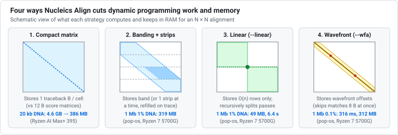

# Algorithms and references

[Documentation index](README.md)

Nucleics Align starts from Isaac Turner's scalar Needleman-Wunsch and Smith-Waterman aligners in [seq-align](https://github.com/noporpoise/seq-align). Every speed-up added on top (striped SIMD, prefix-scan lazy-F, difference-encoded lanes, exact banding, A\*PA2 strip narrowing, linear-space Hirschberg/Myers-Miller, wavefront alignment, and Myers' bit-vector edit distance) was written from scratch in C11 directly from the published papers, with no external alignment libraries wrapped. If you use Nucleics Align in a paper, please cite [`CITATION.cff`](../CITATION.cff) along with the original papers for the methods you rely on.

  

## The core dynamic programming

| Method | Role in Nucleics Align | Reference |
|---|---|---|
| Global alignment | End-to-end optimal alignment | Needleman & Wunsch 1970, *J Mol Biol* 48:443–453 ([doi:10.1016/0022-2836(70)90057-4](https://doi.org/10.1016/0022-2836(70)90057-4)) |
| Local alignment | Highest-scoring local regions | Smith & Waterman 1981, *J Mol Biol* 147:195–197 ([doi:10.1016/0022-2836(81)90087-5](https://doi.org/10.1016/0022-2836(81)90087-5)) |
| Affine gaps (three matrices) | Separate `MATCH`, `GAP_A`, `GAP_B` states so gap open and extend are exact | Gotoh 1982, *J Mol Biol* 162:705–708 ([doi:10.1016/0022-2836(82)90398-9](https://doi.org/10.1016/0022-2836(82)90398-9)) |
| Linear-space alignment | Divide-and-conquer traceback in $O(n)$ memory | Hirschberg 1975, *Commun ACM* 18:341–343 ([doi:10.1145/360825.360861](https://doi.org/10.1145/360825.360861)) |
| Linear space with affine gaps | Extends Hirschberg to Gotoh's affine gap model (`--linear`) | Myers & Miller 1988, *Comput Appl Biosci* 4:11–17 ([doi:10.1093/bioinformatics/4.1.11](https://doi.org/10.1093/bioinformatics/4.1.11)) |

## Exact speed-ups

| Method | Where it is used | Reference |
|---|---|---|
| Striped SIMD layout | Full matrices and linear-space passes | Farrar 2007, *Bioinformatics* 23:156–161 ([doi:10.1093/bioinformatics/btl582](https://doi.org/10.1093/bioinformatics/btl582)) |
| Prefix-scan lazy-F carries | Striped fills (replaces multi-sweep carry loops along bands) | Idea from Block Aligner: Liu & Steinegger 2023, *Bioinformatics* 39:btad487 ([doi:10.1093/bioinformatics/btad487](https://doi.org/10.1093/bioinformatics/btad487)) |
| Difference-encoded 8/16-bit lanes | Needleman-Wunsch full traceback-byte fills | Suzuki & Kasahara 2018, *BMC Bioinformatics* 19(Suppl 1):45 ([doi:10.1186/s12859-018-2014-8](https://doi.org/10.1186/s12859-018-2014-8)), as in ksw2 |
| Wavefront alignment (WFA) | Both band-width sizing (score-only) and full global alignment with traceback (`--wfa`) | Marco-Sola et al. 2021, *Bioinformatics* 37:456–463 ([doi:10.1093/bioinformatics/btaa777](https://doi.org/10.1093/bioinformatics/btaa777)); match-to-penalty conversion from Eizenga & Paten 2022, *bioRxiv* preprint ([doi:10.1101/2022.01.12.476087](https://doi.org/10.1101/2022.01.12.476087)) |
| Computational volumes (A\*PA2) | Narrowing each strip of an affine-gap band from a lower bound | Groot Koerkamp 2024, WABI, *LIPIcs* 312:17 ([doi:10.4230/LIPIcs.WABI.2024.17](https://doi.org/10.4230/LIPIcs.WABI.2024.17)) |
| Bit-vector edit distance | Unit-cost `--scoreonly` on one thread (`alignment_myers_score()`) | Myers 1999, *J ACM* 46:395–415 ([doi:10.1145/316542.316550](https://doi.org/10.1145/316542.316550)) |

`--nogapsinlongest` (forbidding internal gaps in whichever sequence is longer, or the first on a tie) is an addition of this project.

## Ideas still on the list

- Combining Myers' bit-vector passes with Hirschberg's divide-and-conquer so unit-cost `--linear` gets the same 64-cells-per-word speed-up for full alignments, not just `--scoreonly`.
