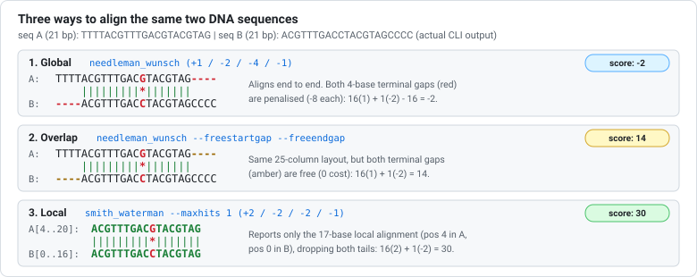

# Command line tools

[Documentation index](README.md)

After running `make`, you have three tools in `bin/`:
- `needleman_wunsch`: optimal global alignment (end to end)
- `smith_waterman`: optimal local alignments, reported best first
- `lcs`: repeated substrings within a single sequence, longest first

`needleman_wunsch` and `smith_waterman` accept sequences on the command line or from FASTA, FASTQ, plain text, or `.gz` files. `lcs` takes a single positional sequence on the command line and does not parse files.

<p align="center">
  
</p>

## Global alignment (`needleman_wunsch`)

Pass two sequences on the command line to align them end to end:

```console
$ ./bin/needleman_wunsch --printscores --pretty GATTACAGATTACA GATCACAGTTACA
GATTACAGATTACA
|||*|||| |||||
GATCACAG-TTACA
score: 5
```

### Choosing the right speed/memory mode

By default, `needleman_wunsch` keeps one traceback byte per cell (12x smaller than full score matrices) and automatically bands similar pairs so most cells are never touched. Five flags give you extra control:

| Flag | When to use it | Trade-off |
|---|---|---|
| `--wfa` | Near-identical pairs (~0.1% divergence, or ≤ 20 kb at ~1%) | 1 Mb at 0.1% in 316 ms (11x faster); on our simulated DNA pairs from 50 kb at ≥ 1% it hits its cell budget (`64 * (len_a + len_b)`, capped at $2^{25}$) and falls back to the matrices |
| `--linear` | Long or divergent pairs (50 kb – 1 Mb+) | $O(n)$ memory (46–64 MB at 1 Mb) instead of gigabytes |
| `--linearabove <n>` | Mixed batches of short and long pairs | Matrices below `n` letters, linear space at or above `n` |
| `--linearfallback` | Safety net on big batches | Switches to linear space only if a pair would run out of memory or overflow matrix dimensions |
| `--scoreonly` | You only need the optimal score | Fastest for scores alone; uses Myers' bit-vector algorithm only under unit costs (`0/-1/0/-1`) on 1 thread when a band does not pay |

> [!NOTE]
> `--linear`, `--linearfallback`, `--linearabove` and `--wfa` always return the same optimal score as the default aligner, but if several alignments tie for the best score they may pick a different one. `--linear`, `--linearabove`, `--wfa` and `--scoreonly` cannot be combined with `--printmatrices` (`--linearfallback` can). `--scoreonly` also cannot be combined with `--zam`, `--pretty` or `--colour`. `--linear` refuses `--freestartgap`, `--freeendgap`, `--nogaps..`, `--nomismatches` and positive `--gapopen` (whereas `--scoreonly` and `--linearabove` fall back to the matrices for those).

`--printmatrices` prints the three Gotoh dynamic programming matrices (`match`, `gap_a`, `gap_b`) before the alignment, which is useful when checking a custom scoring rule:

<details>
<summary>Example <code>--printmatrices</code> output</summary>

```console
$ ./bin/needleman_wunsch --printmatrices ACAGGT AAGGT
seq_a: ACAGGT
seq_b: AAGGT
match_scores:
  0:	  0	-2147483643	-2147483643	-2147483643	-2147483643	-2147483643	-2147483643
  1:	-2147483643	  1	 -7	 -5	 -9	-10	-11
  2:	-2147483643	 -4	 -1	 -3	 -7	 -8	 -9
  3:	-2147483643	 -8	 -6	 -3	 -2	 -6	-10
  4:	-2147483643	 -9	 -7	 -8	 -2	 -1	 -8
  5:	-2147483643	-10	 -8	 -9	-10	 -4	  0
gap_a_scores:
  0:	  0	-2147483643	-2147483643	-2147483643	-2147483643	-2147483643	-2147483643
  1:	 -5	-10	-11	-12	-13	-14	-15
  2:	 -6	 -4	 -9	-10	-11	-12	-13
  3:	 -7	 -5	 -6	 -8	-12	-13	-14
  4:	 -8	 -6	 -7	 -8	 -7	-11	-13
  5:	 -9	 -7	 -8	 -9	 -7	 -6	-11
gap_b_scores:
  0:	  0	 -5	 -6	 -7	 -8	 -9	-10
  1:	-2147483643	-10	 -4	 -5	 -6	 -7	 -8
  2:	-2147483643	-11	 -9	 -6	 -7	 -8	 -9
  3:	-2147483643	-12	-10	-11	 -8	 -7	 -8
  4:	-2147483643	-13	-11	-12	-13	 -7	 -6
  5:	-2147483643	-14	-12	-13	-14	-12	 -9
match: 1 mismatch: -2 gapopen: -4 gapexend: -1

ACAGGT
A-AGGT
```

</details>

## Local alignment (`smith_waterman`)

`smith_waterman` finds the highest-scoring local hits in descending order, showing the 0-based start (`pos`) and aligned span (`len`) in each sequence:

```console
$ ./bin/smith_waterman --pretty \
    acgtttgacgtacgtagctagctgatcgtagctagctagctgatcgatcgtagctagc \
    ttttttacgtttgacgtacgtagcccccgctgatcgtagctagctagctgatcgatcgtaggggggg
== Alignment 0 lengths (58, 67):

hit 0.0 score: 94
  acgtttgacgtacgtagcta--gctgatcgtagctagctagctgatcgatcgtag  [pos: 0; len: 53]
  ||||||||||||||||||**  |||||||||||||||||||||||||||||||||
  acgtttgacgtacgtagcccccgctgatcgtagctagctagctgatcgatcgtag  [pos: 6; len: 55]

hit 0.1 score: 35
  tga-cgtacg-tagctagctgatcg  [pos: 5; len: 23]
  ||| |||| | ||||||||||||||
  tgatcgta-gctagctagctgatcg  [pos: 30; len: 24]

==
```

Key flags for local alignment:
- `--maxhits 1`: if you only want the best hit, always pass this. It avoids filling the full 12-byte score matrices and skips indexing sub-optimal hits. On 20 kb DNA this uses 3–25 MB and runs in 0.01–0.15 s, instead of gigabytes for the full score matrices.
- `--minscore <s>`: ignore hits scoring below `s`. Outside `--stdin`, the default is `match * MAX(0.2 * shorter_length, 2)` (truncated to an integer and clamped to the `score_t` range). Under `--stdin`, the default is `0`.
- `--context <n>`: print `n` flanking bases on either side of each hit (marked with `.` on the pretty line):

```console
$ ./bin/smith_waterman --maxhits 1 --context 4 --pretty \
    acgtttgacgtacgtagctagctgatcgtagctagctagctgatcgatcgtagctagc \
    ttttttacgtttgacgtacgtagcccccgctgatcgtagctagctagctgatcgatcgtaggggggg
== Alignment 0 lengths (58, 67):

hit 0.0 score: 94
      acgtttgacgtacgtagcta--gctgatcgtagctagctagctgatcgatcgtagctag  [pos: 0; len: 53]
      ||||||||||||||||||**  |||||||||||||||||||||||||||||||||....
  ttttacgtttgacgtacgtagcccccgctgatcgtagctagctagctgatcgatcgtaggggg  [pos: 6; len: 55]

==
```

## Reading files and batching

`--file <path>` reads two sequences at a time from FASTA, FASTQ, or plain text (plain or `.gz`):

```console
$ ./bin/needleman_wunsch --printscores --file dna.fa.gz
AC-AATAGAC
ACGAATAGAT
score: 1

ACGTGAC-AGAT
GTG-GACGAGTA
score: -12
```

- `--file -` reads a batch from standard input (piped).
- `--files <f1> <f2>` reads one sequence from `f1` and its partner from `f2`.

### Threads

By default the tools use half your CPU threads (`--threads <n>` overrides it). When reading from files, pairs are aligned concurrently across threads and flushed in exact input order, so the output is byte-for-byte identical to `--threads 1`. Any pair larger than 4 million cells automatically gets all threads to itself. If a pair hits an error (such as an undefined character pair or score overflow), all earlier pairs are printed first and the tool exits non-zero.

### Interactive mode (`--stdin`)

`--stdin` is different from `--file -`: it reads one plain-sequence pair at a time as you type or pipe it (no gzip, no batching, and `smith_waterman` rejects FASTA/FASTQ headers). After each local hit, `smith_waterman --stdin` prompts for `h` (next hit) or `a` (next alignment) and defaults `--minscore` to `0`. This is how the [Perl modules](../README.md#perl) talk to the binaries; for normal pipelines, use `--file -`.

## Scoring options

A gap of $n$ bases scores `gapopen + n * gapextend`. Defaults are `1 / -2 / -4 / -1` for `needleman_wunsch` and `2 / -2 / -2 / -1` for `smith_waterman`.

```console
$ ./bin/needleman_wunsch --scoring BLOSUM62 --printscores --pretty \
    MKTAYIAKQRQISFVKSHFSRQ MKTAHIAKQRISFVKSHFSRQ
MKTAYIAKQRQISFVKSHFSRQ
||||*||||| |||||||||||
MKTAHIAKQR-ISFVKSHFSRQ
score: 88
```

- `--scoring <name>`: built-in matrices with their standard gap penalties: `PAM30` (`-9/-1`), `PAM70` / `BLOSUM80` / `BLOSUM62` (`-10/-1`), and `DNA_HYBRIDIZATION` (`-10/-10`). `--gapopen` and `--gapextend` override them regardless of order.
- `--substitution_matrix <file>`: load any matrix file (see [`scoring/`](../scoring) for BLOSUM, PAM, Gonnet, NUC.4.4, etc.).
- `--substitution_pairs <file>`: load `a b score` lines (`#` starts a comment). Unlisted pairs fall back to `--match`/`--mismatch` if set, otherwise trigger an error.
- `--wildcard <w> <s>`: let character `w` match anything for score `s` (e.g. `--wildcard N 0`).
- `--case_sensitive`: treat `A` and `a` as different characters (off by default).
- `--freestartgap`, `--freeendgap`: make leading/trailing gaps free (global only).
- `--nogaps`, `--nogapsin1`, `--nogapsin2`, `--nogapsinlongest`, `--nomismatches`: forbid internal gaps (end gaps are still allowed) or mismatches.

See [Choosing scores](scoring.md) for practical advice on picking matrices and gap penalties.

## Output options

| Option | What it prints |
|---|---|
| `--printscores` | Score after each global alignment (local hits always print theirs) |
| `--pretty` | Middle line with `\|` (match), `*` (mismatch), space (gap) |
| `--colour` | ANSI terminal colour for mismatches and indels |
| `--printfasta` | FASTA/FASTQ header lines |
| `--printseq` | Full input sequences before local hits (`smith_waterman`) |
| `--context <n>` | `n` flanking bases around each local hit (`smith_waterman`) |
| `--printmatrices` | Full DP score matrices |
| `--zam` | Legacy seq-align format (`Br1:`/`Br2:`, `_` gaps, mismatch & indel counts; cannot be combined with `--printscores`, `--printfasta`, `--pretty`, `--colour` or `--scoreonly`) |

## Common errors

- **Setting only `--match` or only `--mismatch`:** both must be given together, or neither (except `--match` alone is allowed with `--nomismatches`).
- **Undefined character pair:** when using `--substitution_matrix` or `--substitution_pairs`, any letter not in the table (such as `U` or `J` with `scoring/BLOSUM62.txt`, or `X` with `scoring/NUC.4.4.txt`) stops the run unless you add `--wildcard <char> <score>` or provide fallback `--match`/`--mismatch`. By contrast, the built-in `--scoring` presets quietly score unknown letters with a fallback mismatch penalty (`-4` for `BLOSUM62`, `-17` for `PAM30`) instead of failing.
- **Conflicting output flags:** `--scoreonly` cannot be combined with `--zam`, `--pretty`, `--colour` or `--printmatrices`; `--zam` cannot be combined with `--printscores`, `--printfasta`, `--pretty` or `--colour`.
- **`--linear` refusals:** `--linear` exits with an error if combined with `--freestartgap`, `--freeendgap`, `--nogaps..`, `--nomismatches`, `--printmatrices`, or a positive `--gapopen`. Use `--linearabove` or `--scoreonly` if you want automatic fallback to the matrices.

## Longest common substrings (`lcs`)

`lcs` takes one positional sequence on the command line (no file input) and prints repeated substrings in descending order of length with their 0-based start positions:

```console
$ ./bin/lcs ACGTACGTTACGACGT
ACGT [0,4]
ACGT [0,12]
TACG [3,8]
ACGT [4,12]
ACG [0,9]
ACG [9,12]
T [7,8]
T [8,15]
```

## Full `--help` reference

<details>
<summary><code>needleman_wunsch</code></summary>

```text
usage: ./bin/needleman_wunsch [OPTIONS] [seq1 seq2]
  Needleman-Wunsch optimal global alignment (maximises score).
  Takes a pair of sequences on the command line, or can read from a
  file and from sequence piped in.  Can read gzip files, FASTA and FASTQ.

  OPTIONS:
    --file <file>        Sequence file reading with gzip support - read two
                         sequences at a time and align them
    --files <f1> <f2>    Read one sequence from each file to align at one time
    --stdin              Read pairs from STDIN one at a time, interactively
                         (for a batch, use '--file -')

    --case_sensitive     Use case sensitive character comparison [default: off]

    --match <score>      [default: 1]
    --mismatch <score>   [default: -2]
    --gapopen <score>    [default: -4]
    --gapextend <score>  [default: -1]

    --scoring <PAM30|PAM70|BLOSUM80|BLOSUM62|DNA_HYBRIDIZATION>
    --substitution_matrix <file>  see details for formatting
    --substitution_pairs <file>   see details for formatting

    --wildcard <w> <s>   Character <w> matches all characters with score <s>

    --threads <n>        Threads to use, within an alignment and for aligning
                         pairs from a file at once [default: half the CPUs]


    --freestartgap       No penalty for gap at start of alignment
    --freeendgap         No penalty for gap at end of alignment

    --printscores        Print optimal alignment scores
    --zam                A funky type of output
    --linear             Align in linear memory (Hirschberg, Myers-Miller)
    --scoreonly          Print only the score (fast, linear memory)
    --linearfallback     Align in linear memory where too big for the matrices
                         (same score, but may pick another equal-scoring
                         alignment)
    --linearabove <n>    Align in linear memory where either sequence has at
                         least <n> letters (as --linearfallback)
    --wfa                Align similar pairs by the wavefront algorithm, much
                         faster for near-identical ones (same score, but may
                         pick another equal-scoring alignment)
    --printmatrices      Print dynamic programming matrices
    --printfasta         Print fasta header lines
    --pretty             Print with a descriptor line
    --colour             Print with colour

  Experimental Options:
    --nogapsin1          No gaps allowed within the first sequence
    --nogapsin2          No gaps allowed within the second sequence
    --nogaps             No gaps allowed in either sequence
    --nogapsinlongest    No gaps allowed within the longer sequence
    --nomismatches       No mismatches allowed (cannot be used with --nogaps..)

 DETAILS:
  * For help choosing scoring, see docs/scoring.md.
  * Gap (of length N) penalty is: (open+N*extend)
  * To do alignment without affine gap penalty, set '--gapopen 0'.
  * Scoring files should be matrices, with entries separated by a single
    character or whitespace. See files in the 'scoring' directory for examples.

  https://github.com/DanielTillett/nucleics-align  (compiled: <date>)
```

</details>

<details>
<summary><code>smith_waterman</code></summary>

```text
usage: ./bin/smith_waterman [OPTIONS] [seq1 seq2]
  Smith-Waterman optimal local alignment (maximises score).
  Takes a pair of sequences on the command line, or can read from a
  file and from sequence piped in.  Can read gzip files, FASTA and FASTQ.

  OPTIONS:
    --file <file>        Sequence file reading with gzip support - read two
                         sequences at a time and align them
    --files <f1> <f2>    Read one sequence from each file to align at one time
    --stdin              Read pairs from STDIN one at a time, interactively
                         (for a batch, use '--file -')

    --case_sensitive     Use case sensitive character comparison [default: off]

    --match <score>      [default: 2]
    --mismatch <score>   [default: -2]
    --gapopen <score>    [default: -2]
    --gapextend <score>  [default: -1]

    --scoring <PAM30|PAM70|BLOSUM80|BLOSUM62|DNA_HYBRIDIZATION>
    --substitution_matrix <file>  see details for formatting
    --substitution_pairs <file>   see details for formatting

    --wildcard <w> <s>   Character <w> matches all characters with score <s>

    --threads <n>        Threads to use, within an alignment and for aligning
                         pairs from a file at once [default: half the CPUs]

    --minscore <score>   Minimum required score
                         [default: match * MAX(0.2 * length, 2)]
    --maxhits <hits>     Maximum number of results per alignment
                         [default: no limit]

    --context <n>        Print <n> bases of context
    --printseq           Print sequences before local alignments
    --printmatrices      Print dynamic programming matrices
    --printfasta         Print fasta header lines
    --pretty             Print with a descriptor line
    --colour             Print with colour

  Experimental Options:
    --nogapsin1          No gaps allowed within the first sequence
    --nogapsin2          No gaps allowed within the second sequence
    --nogaps             No gaps allowed in either sequence
    --nogapsinlongest    No gaps allowed within the longer sequence
    --nomismatches       No mismatches allowed

 DETAILS:
  * For help choosing scoring, see docs/scoring.md.
  * Gap (of length N) penalty is: (open+N*extend)
  * To do alignment without affine gap penalty, set '--gapopen 0'.
  * Scoring files should be matrices, with entries separated by a single
    character or whitespace. See files in the 'scoring' directory for examples.

  https://github.com/DanielTillett/nucleics-align  (compiled: <date>)
```

</details>

<details>
<summary><code>lcs</code></summary>

```text
./bin/lcs [options] <sequence>
  Print substrings in decreasing order of length
```

</details>
