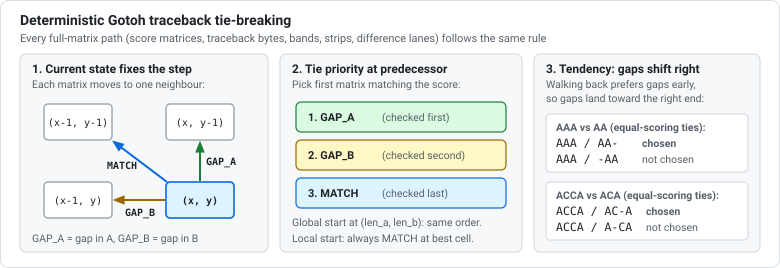

# Using the C library

[Documentation index](README.md)

After `make`, link your C or C++ code against `src/libalign.a` and `libs/string_buffer/libstrbuf.a` with `-lpthread -lz`:

```sh
cc -O3 myprog.c -I src -I libs -L src -L libs/string_buffer -lalign -lstrbuf -lpthread -lz
```

## Minimal example

```c
#include <stdio.h>
#include "needleman_wunsch.h"

int main(void) {
  scoring_t scoring;
  scoring_system_default(&scoring);

  nw_aligner_t *nw = needleman_wunsch_new();
  nw->compact = true; // 1 traceback byte/cell, enables banding & SIMD
  alignment_t *aln = alignment_create(256);

  aln_error_t err;
  if (needleman_wunsch_align_checked("GATTACAGATTACA", "GATCACAGTTACA",
                                     14, 13, &scoring, nw, aln, &err) != ALN_OK) {
    alignment_fprint_error(stderr, &err);
    return 1;
  }
  printf("%s\n%s\nscore: %d\n", aln->result_a, aln->result_b, aln->score);

  alignment_free(aln);
  needleman_wunsch_free(nw);
  return 0;
}
```

More complete C and C++ programs live in [`examples/`](../examples/README.md) (`nw_example.c`, `sw_example.c`, and C++ versions).

## Quick API reference

### Result buffer (`alignment.h`)

```c
typedef struct {
  char *result_a, *result_b; // NUL-terminated aligned strings (gaps as '-')
  size_t capacity, length;   // allocated capacity; length of aligned strings
  size_t pos_a, pos_b;       // 0-based start in seq_a / seq_b (0 for global)
  size_t len_a, len_b;       // bases consumed from seq_a / seq_b
  score_t score;             // optimal alignment score (int)
} alignment_t;

alignment_t *alignment_create(size_t capacity);
void         alignment_free(alignment_t *result);
```

Reuse one `alignment_t` and one aligner across a loop of pairs: buffers grow on demand and stay allocated between calls.

### Global alignment (`needleman_wunsch.h`)

```c
nw_aligner_t *needleman_wunsch_new(void);
void          needleman_wunsch_free(nw_aligner_t *nw);

void needleman_wunsch_align(const char *a, const char *b,
                            const scoring_t *scoring,
                            nw_aligner_t *nw, alignment_t *result);

void needleman_wunsch_align2(const char *a, const char *b,
                             size_t len_a, size_t len_b,
                             const scoring_t *scoring,
                             nw_aligner_t *nw, alignment_t *result);

aln_status_t needleman_wunsch_align_checked(const char *a, const char *b,
                                            size_t len_a, size_t len_b,
                                            const scoring_t *scoring,
                                            nw_aligner_t *nw,
                                            alignment_t *result,
                                            aln_error_t *err);
```

Set `nw->compact = true` whenever you do not need to inspect the raw score matrices afterwards. It uses 12x less memory (one traceback byte per cell) and enables exact banding and difference-encoded SIMD lanes.

### Local alignment (`smith_waterman.h`)

```c
sw_aligner_t *smith_waterman_new(void);
void          smith_waterman_free(sw_aligner_t *sw);
void          smith_waterman_set_min_score(sw_aligner_t *sw, score_t min_score);
void          smith_waterman_set_compact(sw_aligner_t *sw, bool compact);
void          smith_waterman_set_options(sw_aligner_t *sw,
                                         const alignment_options_t *opts);

void smith_waterman_align(const char *a, const char *b,
                          const scoring_t *scoring, sw_aligner_t *sw);
int  smith_waterman_fetch(sw_aligner_t *sw, alignment_t *result); // 1=hit, 0=done

aln_status_t smith_waterman_align_checked(const char *a, const char *b,
                                          size_t len_a, size_t len_b,
                                          const scoring_t *scoring,
                                          sw_aligner_t *sw, aln_error_t *err);
int          smith_waterman_fetch_checked(sw_aligner_t *sw, alignment_t *result,
                                          aln_error_t *err);
```

Do not modify `seq_a`, `seq_b` or `scoring` between `smith_waterman_align()` and `smith_waterman_fetch()`. If you only want the best hit, call `smith_waterman_set_compact(sw, true)` before aligning; if you later ask for a second hit, it fills the full matrices automatically.

### Linear-space global alignment & score-only (`hirschberg.h`)

```c
bool hirschberg_align(const char *a, const char *b,
                      const scoring_t *scoring, alignment_t *result);
bool hirschberg_align_opts(const char *a, const char *b,
                           size_t len_a, size_t len_b,
                           const scoring_t *scoring,
                           const alignment_options_t *opts,
                           alignment_t *result);
bool hirschberg_score(const char *a, const char *b,
                      const scoring_t *scoring, score_t *score);
bool hirschberg_score_opts(const char *a, const char *b,
                           size_t len_a, size_t len_b,
                           const scoring_t *scoring,
                           const alignment_options_t *opts,
                           score_t *score);

aln_status_t hirschberg_align_checked(const char *a, const char *b,
                                      size_t len_a, size_t len_b,
                                      const scoring_t *scoring,
                                      const alignment_options_t *opts,
                                      alignment_t *result, aln_error_t *err);
aln_status_t hirschberg_score_checked(const char *a, const char *b,
                                      size_t len_a, size_t len_b,
                                      const scoring_t *scoring,
                                      const alignment_options_t *opts,
                                      score_t *score, aln_error_t *err);
```

### Direct WFA and Myers helpers (`alignment.h`)

Build a `sub_table_t` for the sequence pair first, and free it when done:

```c
bool sub_table_build(sub_table_t *t, const scoring_t *scoring,
                     const char *a, size_t len_a,
                     const char *b, size_t len_b);
void sub_table_free(sub_table_t *t);

aln_status_t alignment_wfa_align(const sub_table_t *table, const scoring_t *scoring,
                                 const char *seq_a, size_t len_a,
                                 const char *seq_b, size_t len_b,
                                 size_t budget, alignment_t *result);
bool alignment_wfa_score(const sub_table_t *table, const scoring_t *scoring,
                         const char *seq_a, size_t len_a,
                         const char *seq_b, size_t len_b,
                         size_t budget, score_t *score);
bool alignment_myers_score(const sub_table_t *table, const scoring_t *scoring,
                           const char *seq_a, size_t len_a,
                           const char *seq_b, size_t len_b, score_t *score);
```

`alignment_wfa_align()` (`budget` in wavefront cells) returns `ALN_ERR_UNSUPPORTED` when the scoring is unsupported (anything other than one match score, one mismatch score, and standard gap penalties), when the wavefront exceeds `budget`, or if WFA setup/wavefront allocation fails; it returns `ALN_ERR_NOMEM` if reserving the output `alignment_t` buffer fails. `alignment_wfa_score()` takes `budget` in diagonal updates and returns `false` on unsupported scoring, budget exhaustion, or allocation failure. Unlike calling WFA directly, `needleman_wunsch_align_checked()` with `opts.wfa_align = true` automatically falls back to the matrix aligner whenever WFA does not finish.

### Scoring setup (`alignment_scoring.h`)

```c
void scoring_system_default(scoring_t *scoring);
bool scoring_system_by_name(scoring_t *scoring, const char *name); // PAM30, BLOSUM62, ...
void scoring_init(scoring_t *scoring, int match, int mismatch,
                  int gap_open, int gap_extend,
                  bool no_start_gap_penalty, bool no_end_gap_penalty,
                  bool no_gaps_in_a, bool no_gaps_in_b,
                  bool no_mismatches, bool case_sensitive);
void scoring_add_wildcard(scoring_t *scoring, char c, int score);
void scoring_add_mutation(scoring_t *scoring, char a, char b, int score);
void scoring_make_case_sensitive(scoring_t *scoring);
```

## Per-aligner settings (`alignment_options_t`)

Everything that tunes speed or threading without changing the result lives in `alignment_options_t` (`src/alignment.h`). Start with `alignment_options_default(&opts)`, adjust what you need, and attach it via `nw->options = &opts`, `smith_waterman_set_options(sw, &opts)`, or `hirschberg_*_opts()`. That way different threads can run with independent settings without touching global variables.

> [!IMPORTANT]
> Three fields in `alignment_options_t` *can* change which equal-scoring alignment is returned (all three are off by default):
> - `linear_fallback` (`alignment_linear_fallback`): fall back to linear space if a pair is too big for matrices or runs out of memory.
> - `linear_above` (`alignment_linear_above`): use linear space whenever the longer sequence has at least this many letters.
> - `wfa_align` (`alignment_wfa_alignment`): try `alignment_wfa_align()` first for similar pairs (within a cell budget), falling back to the matrices otherwise.
>
> All three always return the same optimal score.

## Equal-scoring alignments

When two alignments share the same optimal score, the choice is deterministic and identical across every full-matrix path (score matrices, traceback bytes, exact bands, strip-kept bands, and difference-encoded lanes):

<p align="center">
  
</p>

- **Starting cell:** Needleman-Wunsch starts at the bottom-right cell `(len_a, len_b)` in the best matrix in the order `GAP_A`, `GAP_B`, `MATCH`. Smith-Waterman starts in `MATCH` at the highest-scoring cell (breaking ties by lowest end coordinate `x` in `seq_a`, then `y` in `seq_b`).
- **Each step back:** The current matrix fixes the spatial step (`GAP_A` moves to `(x, y-1)`, `GAP_B` to `(x-1, y)`, `MATCH` to `(x-1, y-1)`). At that predecessor cell, traceback picks the first matrix in the order `GAP_A`, `GAP_B`, `MATCH` whose score plus the step's penalty equals the current score. That tends to push gaps toward the right end of runs (for example, `AAA` vs `AA` gives `AA-`, and `ACCA` vs `ACA` gives `AC-A`).
- **Local hits:** Candidate hits are sorted by score (highest first), then by the hit's end cell (lowest `x`, then lowest `y`). The returned `pos_a` and `pos_b` are the 0-based start coordinates computed during traceback. A hit stops at score `0`, and any candidate path that touches a cell already used by an earlier hit is discarded.
- **Linear space & WFA:** `--linear` (`hirschberg_align()`) and `--wfa` (`alignment_wfa_align()`) always find the same optimal score, but use their own midpoint or wavefront tie-breaking.

## Error handling (`*_checked()`)

The error contract differs by function family:
- **`needleman_wunsch_align()` / `smith_waterman_align()`:** print to `stderr` and call `exit(EXIT_FAILURE)` on invalid input, overflow, or OOM.
- **`hirschberg_align()` / `hirschberg_score()` (and `*_opts()`):** return `false` on unsupported options, undefined character pairs, or score overflow, and call `exit(EXIT_FAILURE)` on OOM.
- **`needleman_wunsch_align_checked()`, `smith_waterman_align_checked()`, `hirschberg_align_checked()`, `hirschberg_score_checked()`:** return an `aln_status_t` for every error including OOM and optionally populate `aln_error_t` (which `alignment_fprint_error()` formats for you).
- **`smith_waterman_fetch_checked()`:** returns `1` for a hit, and `0` both when hits are exhausted and on error. Pass a non-NULL `aln_error_t *err` and check `err->status != ALN_OK` when it returns `0` to distinguish an error from end-of-hits.

| Status | Meaning |
|---|---|
| `ALN_OK` | Success |
| `ALN_ERR_SCORING` | A character pair has no defined score (`err->a`, `err->b` give the pair) |
| `ALN_ERR_TOO_LONG` | Matrix dimensions would overflow `size_t` |
| `ALN_ERR_OVERFLOW` | Scores could overflow `int` (or drop below the DP floor) |
| `ALN_ERR_UNSUPPORTED` | Linear space or WFA does not support these options or penalties (or direct WFA hit its cell budget) |
| `ALN_ERR_NOMEM` | Out of memory during alignment (no partial state is left behind; the aligner stays valid for subsequent calls) |

Keep individual scores within `[-SCORE_ABS_MAX, SCORE_ABS_MAX]` (`INT_MAX / 4`). Creating an aligner or result buffer (`needleman_wunsch_new()`, `alignment_create()`) still exits on OOM.

## Printing helpers

`alignment_colour_fprint_against()` and `alignment_fprint_spacer()` write coloured alignments and `|`/`*` marker lines to any `FILE *`.
