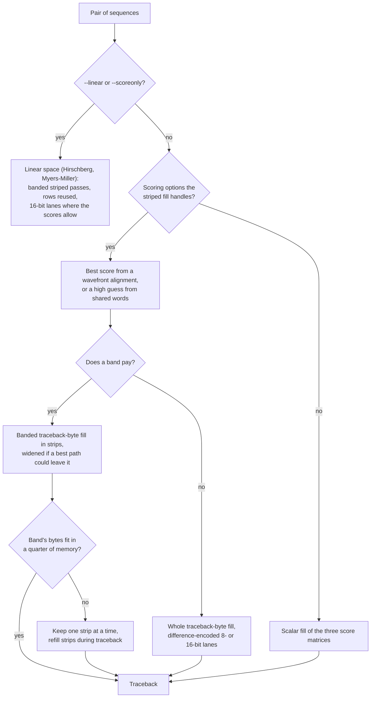

# Performance

[Documentation index](README.md)

Every speed-up here gives the same scores and alignments as the code before
it; see [Changelog](../CHANGELOG.md) for the few deliberate output changes.

- [At a glance](#at-a-glance)
- [How a global alignment is run](#how-a-global-alignment-is-run)
- [Where the speed comes from](#where-the-speed-comes-from)
- [Comparison with other aligners](#comparison-with-other-aligners)
- [Summary](#summary)

## How a global alignment is run

A simplified view of the paths `needleman_wunsch` can take; each gives the
same alignment as the plain full-matrix fill, except that linear space may
pick another of several equal-scoring alignments.

## At a glance

Time per alignment of simulated sequences (about 10% substitutions and 2%
insertions/deletions), measured on an AMD Ryzen AI Max+ 395 under WSL2 with
gcc 15.2 at `-O3`. "Before" is the original seq-align code; every
version gives identical scores and alignments.

| Workload | Before | Now | Now, `NATIVE=1` |
|---|---|---|---|
| Needleman-Wunsch, 5 kb DNA | 0.252 s | 0.046 s | 0.045 s |
| Needleman-Wunsch, 2 kb protein (BLOSUM62) | 0.031 s | 0.005 s | 0.005 s |
| Linear space (`--linear`), 5 kb DNA | n/a | 0.030 s | 0.026 s |
| Smith-Waterman, 3 kb DNA, best 20 hits | 0.636 s | 0.096 s | 0.094 s |

Timings vary by a few per cent between runs.

Time and peak memory for one global alignment (`needleman_wunsch
--printscores`, whole program, best of three; measured on 21 Nov 2026 with
the default build, over pairs from 1% divergence to unrelated):

| Sequences | Full matrices | `--linear` | `--scoreonly` |
|---|---|---|---|
| 5 kb | <0.01-0.01 s, 2-26 MB | <0.01 s, 2 MB | <0.01 s, 2 MB |
| 20 kb | 0.01-0.06 s, 11-388 MB | 0.02-0.04 s, 2 MB | <0.01-0.01 s, 2 MB |
| 50 kb | 0.06-0.36 s, 54 MB-2.4 GB | 0.07-0.19 s, 3-7 MB | 0.02-0.07 s, 3-7 MB |

The full-matrix aligner keeps one traceback byte per cell, and for similar
sequences only near the main diagonals (see below); with `--printmatrices`
it keeps the score matrices, 12 bytes per cell (5 kb 289 MB, 20 kb 4.6 GB).
By divergence, full-matrix aligner, 50 kb: 1% 0.06 s and 54 MB, 5% 0.34 s
and 2.4 GB, 10% 0.11 s and 474 MB, 25% 0.36 s and 2.4 GB, unrelated 0.29 s
and 2.4 GB; 20 kb: 1% 0.01 s and 11 MB, otherwise 0.05-0.06 s and 386-388
MB. At 5% the band did not pay and the whole matrix was filled, so that pair
took longer than the 10% one.

For 20 kb and 50 kb pairs with substitutions and equal numbers of
insertions and deletions, `--linear` and `--scoreonly` took:

| Divergence | 20 kb `--linear` | 20 kb `--scoreonly` | 50 kb `--linear` | 50 kb `--scoreonly` |
|---|---|---|---|---|
| 1% substitutions, 0.2% indels | 0.02 s | <0.01 s | 0.07 s | 0.02 s |
| 5%, 1% | 0.03 s | 0.01 s | 0.13 s | 0.02 s |
| 10%, 2% | 0.04 s | 0.01 s | 0.16 s | 0.03 s |
| 25%, 5% | 0.04 s | 0.01 s | 0.19 s | 0.06 s |
| unrelated | 0.04 s | 0.01 s | 0.16 s | 0.07 s |

Before banding the same runs took 0.11-0.22 s, 0.02-0.05 s, 0.53-1.06 s and
0.11-0.27 s.

Measured on 32 CPUs; large fills and passes use up to half of them. Threads
wait for each other by spinning, so CPU time can be several times the wall
time (50 kb unrelated sequences, `--linear`: 0.18 s wall, 1.0 s CPU).

Pairs from a file are aligned several at a time (see [threads](command-line.md#threads)):
3,000 pairs of 0.2-2 kb took 0.50 s instead of 4.93 s (Needleman-Wunsch),
0.69 s instead of 7.48 s (`--linear`), 0.31 s instead of 2.54 s
(`--scoreonly`) and 0.63 s instead of 5.05 s (`smith_waterman --maxhits
1`), with the same output.

## Where the speed comes from

Each change, roughly in the order it was made. The timings in each item
were measured when that change went in, against the code just before it;
later changes sped several cases up further, so the tables above and the
[comparison](#comparison-with-other-aligners) below give the current
figures.
* A substitution score table for the characters in the two sequences replaces
  a `scoring_lookup()` call per cell
* The matrix fill uses Farrar's striped SIMD layout (Farrar 2007,
  Bioinformatics 23:156-161), written with GCC/clang vector extensions so it
  builds on x86 and ARM. Options that change the recurrence for particular
  cells (free end gaps, `--nogaps..`, `--nomismatches`) use the scalar fill
* The linear-space aligner's forward and reverse passes use the same striped
  layout, with Farrar's lazy F loop carrying insertion gaps across segment
  boundaries. Its rows match the scalar passes exactly, so the alignment is
  unchanged. Used where the CPU has a vector max instruction (see [Building](../README.md#building)), on
  sub-problems large enough to repay building the score profile, with gap
  penalties of zero or less, and while every score stays far from 32-bit
  overflow
* In large passes the columns are split into blocks, one thread each, every
  thread one row behind the block on its left. Each block hands the next
  its last column's score and the insertion gap leaving it, so the result is
  the same as one thread. The forward and reverse passes also run at the
  same time (20 kb `--linear` 0.79 -> 0.19 s, `--scoreonly` 0.30 -> 0.04 s)
* The full-matrix striped fill is split into column blocks the same way,
  each block reading its left neighbour's last column straight from the
  matrices (20 kb Needleman-Wunsch 0.78 -> 0.35 s). Smith-Waterman gains less
  (20 kb 6.6 -> 6.2 s), as most of its time goes on finding hits
* The command line tools keep one traceback byte per cell instead of three
  4-byte scores (as ksw2 does). For each of the three matrices the byte
  records which matrix the traceback steps back to, found during the fill
  with the same tests in the same order as the usual traceback, so the
  alignment is identical. Most of the full-matrix time went on allocating
  and first touching the matrices: 20 kb Needleman-Wunsch 0.36 -> 0.08 s and
  4.6 GB -> 0.39 GB, and 50 kb (~30 GB before) now takes 0.4 s and 2.4 GB.
  Options the striped fill does not handle, and free start gaps, keep the
  score matrices
* `smith_waterman --maxhits 1` uses the same traceback bytes, with the fill
  also finding the best cell (highest score, then lowest position in the
  first sequence, then the second: the first hit of a full search). Only if
  a second hit is wanted are the score matrices filled and every cell
  indexed. 20 kb, best hit: 2.5-3.0 s -> 0.09-0.11 s, 5.6 GB -> 0.45 GB
* The traceback-byte fill uses the linear-space aligner's exact banding: a
  narrow band is filled first, in strips of rows, and widened (or the whole
  matrix filled) if the score found shows a best path could leave it. No
  cell outside a band that held can tie with a cell on a best path, so the
  traceback takes the same steps. Only the band's bytes are kept. 50 kb at
  1% divergence: 0.40 -> 0.15 s, 6.0 -> 0.14 s of CPU, 2.4 GB -> 92 MB.
  A band is used only where it beats the whole fill on its threads
* For a compact Smith-Waterman best hit of more than 2^24 cells, a
  score-only scan finds the best score and where it ends, and a scan of the
  reversed sequences up to there finds where every best path starts. Only
  that rectangle gets traceback bytes (as SSW does, but with the same hit
  as the full search). 100 kb sequences sharing a 2 kb region: 3.1 -> 0.34
  s and 11.6 GB -> 22 MB; 300 kb ones take 3.3 s and 66 MB (they did not fit
  in 40 GB before). The first scan gives up once the best rises at half the
  top substitution score per row from near the start: such a hit spans the
  sequences, and the whole fill is quicker. Not used where a gap scores
  above 0, as a hit can then start with a gap
* Smith-Waterman fills and scans use 16-bit lanes, twice as many per
  vector, where the scores allow (every cell lies between 0 and the best
  score so far), and fill each row in one pass: match, both gaps and the
  row's best cell together, with the lazy F loop adding what each lane
  passes to the next. A row whose best comes near the 16-bit limit, or a
  best rising fast enough to reach it, starts the fill again with 32-bit
  lanes. One thread, 20 kb: the score scan 0.125 -> 0.056 s (unrelated)
  and 0.29 -> 0.14 s (1%), the best hit with traceback bytes 0.33 -> 0.22 s
  and 0.49 -> 0.29 s; with `NATIVE=1` on AVX-512 the unrelated scan takes
  0.025 s (16 Gcells/s). 3,000 local best hits: 0.50 -> 0.33 s
* Smith-Waterman starts with 8-bit lanes, 4 times as many as 32-bit ones
  (as SSW does, but signed and with the same results), where every
  substitution score and gap penalty fits in a byte: then 16-bit lanes,
  then 32-bit, as the best grows. Lanes cannot hold a segment number here,
  so a row that reaches the best finds its first cell by searching the lane
  that holds it. Between unrelated sequences the best rises ever more
  slowly, so the check for a best that will outgrow the lanes projects from
  its rise over the last half of the rows, not from the start. One thread,
  20 kb unrelated: the score scan 0.057 -> 0.017 s (24 Gcells/s; 0.014 s
  with `NATIVE=1` on AVX-512). With the scan this cheap, compact best hits
  of more than 2^24 cells (was 2^30) start with it: 20 kb unrelated
  `smith_waterman --maxhits 1` 0.09 -> 0.01 s and 448 -> 5 MB, with related
  pairs as before
* Needleman-Wunsch traceback bytes are filled with difference-encoded lanes
  (after Suzuki & Kasahara 2018, as ksw2 does) where the whole matrix is
  filled: each cell is kept as its difference from the cell above, which
  stays small at any length, so 8-bit lanes (4 times as many as 32-bit
  ones) hold them with DNA scoring and 16-bit lanes with BLOSUM62. Every
  traceback byte comes from comparing values with the same reference, so
  the bytes, and the alignment, are those of the 32-bit fill. More lanes
  made the lazy F loop wrap more (gap_b carried across 4 times as many lane
  boundaries: 20 kb at 10%, 12 sweeps of each row instead of 3), so what
  each lane passes to the next is found first, by a scan over the lanes
  in absolute scores, and one pass then applies it. One thread, 20 kb fill:
  10% 0.40 -> 0.20 s, unrelated 0.28 -> 0.18 s. Bands are filled in strips
  of at least 64 rows (was 256), which makes a band 6-30% quicker and a
  first band that proves too narrow cheaper
* A fill across the whole width takes column blocks of at least 2,048
  columns (twice `block_min_cols`), so a 20 kb pair runs on about 10 threads
  instead of 16: the extra threads finished each row too soon after the
  block on their left and mostly waited. The same wall time with 40-45% less
  CPU (20 kb: Needleman-Wunsch at 10% 0.83 -> 0.48 s of CPU, the best local
  hit at 1% 0.92 -> 0.53 s). A band's strips keep 1,024, or narrow bands
  lose their threads (50 kb at 10%: 0.15 -> 0.29 s)
* Before banding, 128 words of 12 letters of the first sequence are looked
  for near where they would lie in the second, for a high guess at the best
  score. If even the band that guess needs could not pay, the band is not
  tried: 20 kb at 10-20% divergence and unrelated 0.048-0.053 -> 0.040-0.047
  s, 50 kb at 20% and unrelated about 10% quicker. The guess only decides
  whether to try a band, never the alignment
* Before that, with one match and one mismatch score and nothing else
  changed (no free end gaps, wildcards or gap rules), a score-only
  wavefront alignment (WFA, see [algorithms](algorithms.md)) looks for the best score
  itself, for up to 16 diagonal updates per letter
  (`alignment_band_wfa_budget`). Its time grows with the square of the
  divergence, so it finishes only for close pairs, and then the band that
  score needs is filled once, instead of a 64-wide band first and wider
  ones after. Otherwise the guess and the narrow band go on as before. The
  band proof is unchanged, so the alignment is the same either way. 0.1%
  divergence: 50 kb 0.040 -> 0.018 s, 100 kb 0.098 -> 0.060 s, 300 kb
  0.51 -> 0.41 s; 20 kb at 0.5% 0.017 -> 0.011 s. Where it gives up it
  costs 0-5% (50 kb at 0.5%: 0.069 -> 0.072 s). Larger budgets let it
  finish at 1 Mb and 0.1%, but the exact band was then slower there (4.5
  -> 5.3 s), likely because the narrower band runs on fewer threads
* Once a band has a lower bound on the best score (the wavefront score, or
  the score of the alignment a band too narrow found), each strip covers
  only the diagonals that the cells above it can still reach while
  scoring that much: a cell's bound is its score plus a match for every
  letter left of the shorter remainder and a gap extension for the
  difference. A cell whose bound is below the best score is on no best
  path and cannot tie with one, so leaving it out changes no cell the
  traceback reads, and the alignment is the same. This is the
  computational volume of A*PA2 (see [algorithms](algorithms.md)), there for edit
  distance, here with affine gaps and only between strips. On the 8-core
  machine below, best of 3: 1 Mb at 1% 13.6 -> 9.9 s, at 2% 26.4 -> 20.6
  s, at 5% 67.6 -> 55.0 s; 300 kb at 2% 2.71 -> 2.11 s; 100 kb at 1% 0.69
  -> 0.54 s; 50 kb at 0.5% 0.142 -> 0.100 s. 100 kb at 2% and 300 kb at
  0.5% were within 4% either way
* Long global alignments: a band whose traceback bytes would not fit in a
  quarter of the physical memory (`alignment_band_keep_max_cells`) keeps
  only one strip of rows' bytes at a time, and each strip's top row. The
  traceback fills a strip again from its top row when it reaches it, only
  up to the column it has reached, so the bytes and the alignment are the
  same. The band is filled about twice, so smaller bands keep every byte.
  1 Mb pairs at 1% divergence: 34.7 GB -> 350 MB (13.8 -> 18.2 s); at 2%
  and 5% they no longer run out of memory (see [long pairs](#long-pairs))
* Strip alignments: a compact best hit whose region (the rectangle, or the
  whole matrix where a hit spans the sequences) has more than 2^28 cells
  keeps no traceback bytes for it. The scan for the best cell also keeps
  every k-th row of the three matrices (k about sqrt(12 x rows)), and the
  hit is followed back strip by strip from the bottom, each strip's bytes
  filled again from the row kept above it and only up to the hit's column.
  The bytes are those of the whole fill, so the hit is too (a linear-space
  realignment would give the same score but could pick another of several
  equal-scoring alignments). 50 kb pairs sharing the whole sequence:
  1.27 -> 0.62 s and 2.9 GB -> 85 MB; 20 kb: 451 -> 23 MB, and slightly
  faster. Smaller regions keep the threaded fill of every byte, which is
  quicker there (10 kb: 0.03 s against 0.05 s)
* The linear-space aligner's forward and reverse passes share the threads
  rather than taking half the CPUs each, which oversubscribed the cores (50
  kb unrelated `--linear` 0.45 -> 0.33 s and 6.1 -> 2.1 s of CPU)
* The command line tools align pairs from a file several at a time, each
  on its own thread with its own aligner, and print them in input order
  (3,000 pairs of 0.2-2 kb: 8-11x faster)
* gcc builds with run-time selection use 8-lane vectors in every version,
  which also helps without AVX2: fewer segments per row, so the lazy F loop
  wraps less (20 kb unrelated `--scoreonly`, one thread, 0.20 -> 0.10 s).
  `NATIVE=1` on an AVX-512 CPU uses 16 lanes (the same pass 0.10 -> 0.055 s)
* On Linux the score matrices are allocated for transparent huge pages:
  page faults for a 5 kb x 5 kb alignment fall from ~72,000 to ~320, and
  fewer TLB misses speed up the fill itself (5 kb NW 0.060 -> 0.046 s)
* Exact banding in the linear-space aligner: a path through a cell far from
  the main diagonals needs many gap characters, which caps its score. Cells
  that cannot reach the best score are skipped, by running each pass in
  strips of rows over only the columns that might. The bound comes from the
  sub-problem's best score, which the split above it already found; the top
  level first tries a narrow band. If the best score found needs a wider band
  than was used, the pass is rerun wider (or whole), so the result is always
  the same. For similar sequences most cells are skipped: 50 kb at 1%
  divergence 0.9 -> 0.18 s and ~10 s -> 0.25 s of CPU; for unrelated ones
  the narrow first try costs a few milliseconds
* Rows reused down the linear-space recursion: each split runs a forward
  pass over the top half of its rows and a reverse pass over the bottom
  half, and its first half then needs a forward pass from the same corner
  (its second half a reverse pass). A forward row depends only on the rows
  above it and the columns to its left, so the split's own row, cut to the
  half's columns, is exactly the row the half would make. A pass over all
  columns now also saves the rows the next two levels on its side will
  need (`hirschberg_reuse_depth`), and those levels skip that pass. Banded
  passes save nothing, as their rows are exact only along best paths. The
  alignments are the same. 400 kb pairs at 30% divergence 11.8 -> 9.5 s,
  unrelated 9.1 -> 7.5 s; 50 kb unrelated 0.31 -> 0.25 s; similar pairs,
  which are mostly banded, 1-5% faster. Peak memory is about the same (at
  most four more rows per level kept). Saving three levels was slower
  (10.2 s), as each pass is cut into more pieces
* The lazy F loop finds its carries first. Along a band, every cell right
  of the best path is best reached by an insertion gap from the left, so
  Farrar's loop carried each row's gap round all the lanes, one lane per
  sweep: about 8 sweeps of the segment per row against 1 for the fill
  itself. What lane l passes to lane l+1 is now found with a scan over the
  lanes (the better of its own and what it was passed, less a gap
  extension per cell crossed), as Block Aligner does with prefix scans
  (Liu & Steinegger 2023, Bioinformatics 39:btad487), and each lane takes
  its carry once. The values are the same, so are the alignments. 100 kb
  pairs: `--linear` 1% 0.50 -> 0.25 s and 5% 0.84 -> 0.38 s; `--scoreonly`
  1% 0.17 -> 0.08 s; the banded fill 1% 0.35 -> 0.25 s. Unrelated pairs
  and Smith-Waterman, where the carries rarely reach far, are unchanged
* Linear-space passes over every column use 16-bit lanes, twice as many
  per vector. Each block is cut into parts of a few thousand columns (about
  6,000 with the default DNA scores, 1,150 with BLOSUM62), filled a row at a
  time, and a part keeps each row less one 32-bit score: that of the column
  on its left in the same row. Every cell of the row lies within a bound
  set by the part's width and the scores (no lower than a gap across the
  part, no higher than the best substitution score and a gap extension per
  column), so the 16-bit values are exact and the alignment is the same.
  Banded strips keep 32-bit lanes: their cells outside the band stand for
  minus infinity, which no such bound covers. 100 kb pairs: 30% divergence
  `--linear` 0.83 -> 0.48 s and `--scoreonly` 0.35 -> 0.19 s, unrelated
  1.10 -> 0.76 s and 0.31 -> 0.21 s; on one thread `--linear` 4.5 -> 3.5 s
  and 5.1 -> 3.1 s. Close pairs, which are banded, are unchanged
* `--scoreonly` (`hirschberg_score()`): no alignment, no matrices. With a
  band, the forward and reverse passes run at the same time and meet in the
  middle row; otherwise one forward pass over every row
* On x86-64 Linux the SIMD code is compiled for several CPU levels and the
  best is picked when the program starts (see [Building](../README.md#building))
* Smith-Waterman hits are ordered with a counting sort on score instead of a
  comparison sort of every cell. Tied hits are ordered by position in the
  first sequence, then the second, on every platform
* Following Smith-Waterman hits back through the matrices uses the same
  substitution table and fixed gap penalties instead of a general step that
  re-checks every scoring option. Options that change penalties or forbid
  gaps for particular cells use the general step. A walk stops as soon as
  its next cell is already used by an earlier hit, before working out the
  step
* `smith_waterman` never indexes cells scoring below `--minscore`, and stops
  at `--maxhits` without searching for one more hit

When more than one hit is wanted, most of the Smith-Waterman time is still
spent following hits back through the matrices. Each hit marks the cells it
uses, which defines which later hits are reported, so the walk itself is
unchanged.

## Comparison with other aligners

The same machine, with whole-program wall time (best of three runs) and peak
memory. Every tool used the same scoring (match +1, mismatch -2, gap of
length k: -(4+k)) and reported the same optimal score for every pair. The
sequences are random DNA: "1%" has 1% substitutions and 0.2% insertions and
deletions, "10%" has 10% and 2%, and "unrelated" is two independent random
sequences. Nucleics Align uses up to 16 threads and the other tools one, so CPU
time is shown in brackets where it is well above the wall time.

### The tools
* seq-align (original): commit dc41988 (2017), its last commit
* parasail 2.6.2: `nw_trace_striped_32`, `nw_striped_32` and
  `sw_trace_striped_32`
* ksw2 (289609b): `ksw_extz2_sse`, with no band
* WFA2-lib 2.3.5: exact (heuristics off), in the default memory mode and as
  BiWFA (ultralow memory)
* SSW 1.2.5

Nucleics Align was run through `needleman_wunsch` and `smith_waterman`, and the
others through a small C program that reads the two sequences and aligns them
once. The Nucleics Align rows were measured again on 21 Nov 2026 (best of 3,
with `benchmarks/run.sh`, after the 16-bit linear-space passes); the
other rows are from the earlier run, on the same sequences and machine.

### Global alignment, 20 kb

| Tool | 1% | 10% | Unrelated | Peak memory |
|---|---|---|---|---|
| seq-align (original) | 9.55 s | 9.75 s | 10.56 s | 4.6 GB |
| Nucleics Align, full matrix | 0.01 s | 0.06 s (0.57 s) | 0.06 s (0.58 s) | 11 - 386 MB |
| Nucleics Align `--linear` | 0.02 s | 0.04 s (0.07 s) | 0.04 s (0.12 s) | 2 MB |
| parasail | 1.17 s | 1.28 s | 0.76 s | 1.5 GB |
| ksw2 | 0.33 s | 0.35 s | 0.34 s | 524 MB |
| WFA2 | 0.01 s | 0.90 s | 23.3 s | 23 MB - 16.9 GB |
| WFA2 BiWFA | 0.01 s | 0.54 s | 10.3 s | 8 - 24 MB |

### Global alignment, 50 kb

The original would need about 30 GB, so was not run.

| Tool | 1% | 10% | Unrelated | Peak memory |
|---|---|---|---|---|
| Nucleics Align, full matrix | 0.06 s | 0.14 s (0.97 s) | 0.29 s (4.4 s) | 54 MB - 2.4 GB |
| Nucleics Align `--linear` | 0.07 s (0.09 s) | 0.17 s (0.46 s) | 0.18 s (1.0 s) | 3 - 6 MB |
| parasail | 10.1 s | 8.74 s | 5.25 s | 9.5 GB |
| ksw2 | 1.77 s | 1.78 s | 1.71 s | 2.8 GB |
| WFA2 | 0.07 s | 5.23 s | out of memory (28 GB limit) | 87 MB - 6.2 GB |
| WFA2 BiWFA | 0.05 s | 3.07 s | 57.3 s | 7 - 44 MB |

### Global alignment score only

Every tool used under 40 MB.

| Tool | 20 kb 1% | 20 kb 10% | 20 kb unrelated | 50 kb 1% | 50 kb 10% | 50 kb unrelated |
|---|---|---|---|---|---|---|
| Nucleics Align `--scoreonly` | <0.01 s | 0.01 s (0.03 s) | 0.01 s (0.07 s) | 0.02 s (0.03 s) | 0.03 s (0.25 s) | 0.06 s (0.67 s) |
| parasail | 0.18 s | 0.17 s | 0.07 s | 1.14 s | 1.00 s | 0.45 s |
| ksw2 | 0.10 s | 0.10 s | 0.10 s | 0.63 s | 0.62 s | 0.61 s |
| WFA2 | <0.01 s | 0.46 s | 8.47 s | 0.03 s | 2.74 s | 49.5 s |

### Long pairs

Global alignment with the alignment returned
(`needleman_wunsch`), measured on another machine (AMD Ryzen 7 5700G, 8
cores, 16 threads, 62 GB, Linux), one run each, on 21 Nov 2026 (after the
lazy F scan and row reuse, see above):

| Pair | Band, every byte kept | Band kept in strips | `--linear` |
|---|---|---|---|
| 100 kb, 1% | 0.35 s, 268 MB | (kept) | 0.27 s, 6 MB |
| 300 kb, 5% | 2.77 s, 11.6 GB | (kept) | 2.47 s, 20 MB |
| 1 Mb, 0.1% | 3.46 s, 2.6 GB | (kept) | 2.86 s, 45 MB |
| 1 Mb, 0.5% | (in strips) | 5.36 s, 287 MB | 4.19 s, 47 MB |
| 1 Mb, 1% | (in strips) | 7.92 s, 319 MB | 6.33 s, 49 MB |
| 1 Mb, 2% | out of memory | 15.8 s, 467 MB | 10.6 s, 53 MB |
| 1 Mb, 5% | out of memory | 43.3 s, 1.1 GB | 23.6 s, 63 MB |

With 62 GB, bands of up to about 15 GB keep every byte; larger ones are
kept in strips. `--linear` is now the fastest on every pair here (1.1 to
1.8 times the speed of the band) and needs far less memory: the lazy F
scan sped up its passes more than the band fill (1 Mb at 1%: 19.2 -> 6.3 s
against 9.9 -> 7.9 s). Its alignment can differ where several share the
best score (see [equal-scoring alignments](library.md#equal-scoring-alignments)). The score alone (`--scoreonly`) took 0.09-11.8 s.

### Best local hit, 20 kb

`smith_waterman --maxhits 1`:

| Tool | 1% | 10% | Unrelated | Peak memory |
|---|---|---|---|---|
| seq-align (original) | 71.1 s | 61.2 s | 34.5 s | 6.3 - 8.5 GB |
| Nucleics Align | 0.11 s (0.52 s) | 0.12 s (0.56 s) | 0.01 s (0.11 s) | 3 - 21 MB |
| parasail | 0.90 s | 0.83 s | 0.72 s | 1.5 GB |
| SSW | 0.27 s | 0.22 s | 0.03 s | 7 MB |

For the unrelated pair Nucleics Align reports no hit, as the best (score 14) is
below the default `--minscore`. With `NATIVE=1` on AVX-512 the unrelated
pair took under 0.005 s in an earlier run. At 50 kb Nucleics Align's best
hit takes 0.43-0.51 s (4.3-5.2 s CPU) and 86 MB when it spans both
sequences (1.27 s and 2.9 GB before strip alignments), and 0.07 s and 10 MB
for the unrelated pair (the other tools were not run). At 5 kb every global aligner
took 0.07 s or less, except the original seq-align (0.53-0.63 s) and
WFA2 on the unrelated pair (0.65-0.96 s).

## Summary
* Against the original seq-align, the same full-matrix alignment is
  160-960x faster with 12-420x less memory, and the best local hit
  510-3,400x faster with over 300x less memory
* For global alignment Nucleics Align has the lowest wall time of the exact
  aligners tested, except WFA2 on near-identical sequences: 0.01-0.06 s for
  the full-matrix aligner at 20 kb against 0.33-0.35 s for ksw2. WFA2's time
  grows with the number of differences, so it is far slower on divergent or
  unrelated pairs. `--linear` needs only megabytes at any length
* On one core Nucleics Align is now faster than ksw2 too: `needleman_wunsch
  --threads 1` takes 0.11 s on the 20 kb 10% pair and 0.19 s on the
  unrelated one, against ksw2's 0.35 s and 0.34 s. The CPU times in brackets
  above come from the default 16 threads, which mostly wait for their
  neighbours (16 threads are only 4x faster than one); `--threads 4` takes
  0.07 s and 0.28 s of CPU on the unrelated pair. On similar pairs banding
  skips most cells (20 kb at 1%: 0.01 s of CPU)
* For the best local hit Nucleics Align is now faster than parasail and SSW
  in wall time, on unrelated pairs too (0.01 s and 3 MB against SSW's 0.03 s
  and 7 MB), and needs 21 MB where a 20 kb hit spans the sequences (SSW 7
  MB, parasail 1.5 GB). SSW still uses about 2x less CPU time on related
  pairs. On one core Nucleics Align's score scan of the unrelated pair takes
  0.017 s (0.014 s with `NATIVE=1` on AVX-512)
