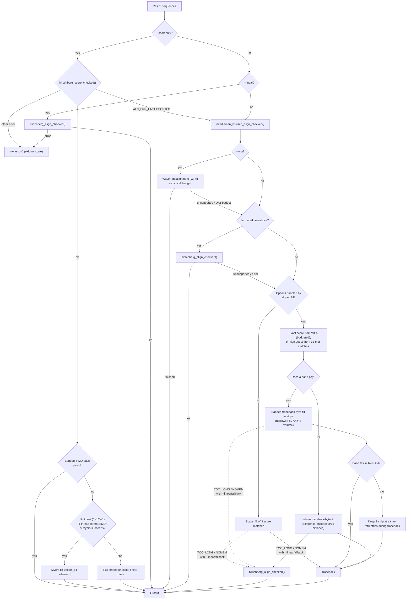
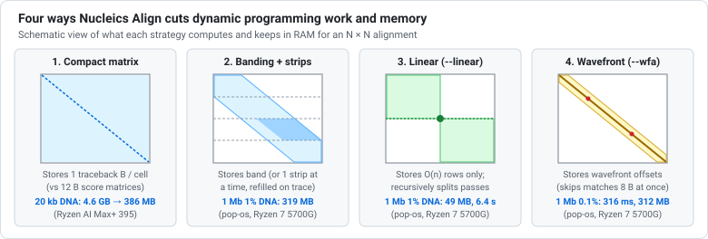
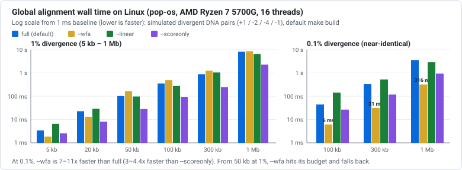

# Performance

[Documentation index](README.md)

The point of forking `seq-align` was to make exact affine-gap alignment fast enough that you do not have to reach for a heuristic tool just to align two 50 kb or 1 Mb sequences. Every default optimisation here produces the same score and alignment as the original code (see [CHANGELOG.md](../CHANGELOG.md) for the few intentional bug fixes).

## How a global alignment is dispatched

When you run `needleman_wunsch`, the CLI dispatches a pair in this order (`src/tools/nw_cmdline.c`, `src/hirschberg.c`, `src/needleman_wunsch.c`):

  

## Benchmarks on Linux (`pop-os`, AMD Ryzen 7 5700G)

Measured on an 8-core / 16-thread desktop (AMD Ryzen 7 5700G, 62 GB RAM, Pop!_OS Linux, default `make` build at `-O3`, default DNA scoring `+1 / -2 / -4 / -1`). Standard pairs (`5 kb – 50 kb`) are best of 3 runs; large pairs (`100 kb – 1 Mb`) are 1 run each, timed with millisecond precision (`time.perf_counter()` + GNU `time` for CPU and peak RSS). **Bold** marks the fastest global mode returning a full alignment (excluding `--scoreonly` and `local --maxhits 1`).

  

### Standard lengths (5 kb – 50 kb, best of 3)

| Length | Div | `full` (wall / MB) | `--wfa` (wall / MB) | `--linear` (wall / MB) | `--scoreonly` (wall / MB) | `local --maxhits 1` (wall / MB) |
|---|---|---:|---:|---:|---:|---:|
| 5 kb | 1% | 3.4 ms / 3 MB | **1.8 ms** / 3 MB | 6.5 ms / 3 MB | 2.6 ms / 3 MB | 21.1 ms / 31 MB |
| 5 kb | 10% | 11.7 ms / 9 MB | 17.4 ms / 10 MB | **9.7 ms** / 3 MB | 4.0 ms / 3 MB | 19.9 ms / 31 MB |
| 5 kb | rand | 13.3 ms / 27 MB | 18.8 ms / 27 MB | **12.7 ms** / 3 MB | 4.4 ms / 2 MB | 7.0 ms / 3 MB |
| 20 kb | 1% | 22.7 ms / 16 MB | **13.1 ms** / 14 MB | 29.0 ms / 3 MB | 8.1 ms / 3 MB | 149.7 ms / 25 MB |
| 20 kb | 10% | 73.8 ms / 388 MB | 102.0 ms / 388 MB | **62.6 ms** / 4 MB | 14.5 ms / 4 MB | 135.0 ms / 24 MB |
| 20 kb | rand | **71.3 ms** / 387 MB | 100.2 ms / 388 MB | 73.4 ms / 4 MB | 20.2 ms / 4 MB | 23.9 ms / 4 MB |
| 50 kb | 1% | 101.2 ms / 71 MB | 166.4 ms / 76 MB | **97.0 ms** / 4 MB | 28.0 ms / 4 MB | 577.4 ms / 87 MB |
| 50 kb | 10% | **165.7 ms** / 584 MB | 244.1 ms / 584 MB | 216.8 ms / 6 MB | 60.7 ms / 6 MB | 546.4 ms / 87 MB |
| 50 kb | rand | 417.1 ms / 2,395 MB | 489.2 ms / 2,396 MB | **276.4 ms** / 8 MB | 97.6 ms / 6 MB | 129.7 ms / 7 MB |

### Large lengths (100 kb – 1 Mb, 1 run)

| Length | Div | `full` (wall / MB) | `--wfa` (wall / MB) | `--linear` (wall / MB) | `--scoreonly` (wall / MB) |
|---|---|---:|---:|---:|---:|
| 100 kb | 0.1% | 44.1 ms / 34 MB | **6.1 ms** / 6 MB | 143.2 ms / 7 MB | 26.6 ms / 6 MB |
| 100 kb | 1% | 350.6 ms / 268 MB | 488.4 ms / 268 MB | **274.7 ms** / 7 MB | 94.6 ms / 6 MB |
| 100 kb | 5% | **409.3 ms** / 1,234 MB | 567.3 ms / 1,234 MB | 515.4 ms / 8 MB | 122.6 ms / 7 MB |
| 300 kb | 0.1% | 337.9 ms / 256 MB | **31.4 ms** / 32 MB | 523.9 ms / 15 MB | 117.5 ms / 15 MB |
| 300 kb | 1% | **876.1 ms** / 2,376 MB | 1,246.2 ms / 2,376 MB | 1,054.1 ms / 16 MB | 246.8 ms / 16 MB |
| 300 kb | 5% | 2,731.3 ms / 11,625 MB | 3,185.1 ms / 11,625 MB | **2,522.6 ms** / 20 MB | 944.7 ms / 19 MB |
| 1 Mb | 0.1% | 3,480.8 ms / 2,641 MB | **315.8 ms** / 312 MB | 2,910.7 ms / 46 MB | 935.2 ms / 43 MB |
| 1 Mb | 1% | 8,103.1 ms / 319 MB *(strips)* | 8,517.2 ms / 392 MB | **6,402.6 ms** / 49 MB | 2,256.7 ms / 46 MB |
| 1 Mb | 5% | *(not run)* | *(not run)* | **24,257.5 ms** / 64 MB | 11,955.8 ms / 61 MB |

I added `--wfa` hoping to speed up close sequences without giving up exactness, and on these simulated DNA pairs (`+1 / -2 / -4 / -1`) at **0.1% divergence** it delivered: **1 Mb in 316 ms** (11x faster than `full`, 9x faster than `--linear`, and 3x faster than `--scoreonly` while returning the full alignment). What surprised me was how sharply the crossover hit at **1% divergence**: `--wfa` still wins at 5 kb and 20 kb, but from 50 kb up it runs into its cell budget (`64 * (len_a + len_b)` cells across the combined length, capped at $2^{25}$) and falls back to the matrices, making it slower than `full` by the cost of that failed attempt.

For longer or more divergent pairs, `full` and `--linear` trade the lead (`full` is faster at 100 kb 5% and 300 kb 1%; `--linear` is faster at 50 kb rand, 100 kb 1%, 300 kb 5% and 1 Mb 1%), while `--linear` keeps peak RAM at **at most 64 MB** even at 1 Mb and 5% divergence. At 1 Mb and 1%, `full` automatically switches to strip-kept bands, dropping peak RAM from ~35 GB to **319 MB** while keeping fixed tie-breaking.

## Other workloads (protein, batching, 1 Mb strips)

- **Protein (2 kb, BLOSUM62, Ryzen AI Max+ 395):** `0.031 s` in original `seq-align` down to `0.005 s` now (same with `NATIVE=1`).
- **Batch threading (3,000 DNA pairs, 0.2–2 kb, Ryzen AI Max+ 395):** `4.93 s → 0.50 s` (`needleman_wunsch`), `7.48 s → 0.69 s` (`--linear`), `2.54 s → 0.31 s` (`--scoreonly`), and `5.05 s → 0.63 s` (`smith_waterman --maxhits 1`), with byte-identical output.
- **1 Mb strip-kept bands on `pop-os` (62 GB RAM, separate strip-memory run on 21 Nov 2026):** once a band would exceed a quarter of RAM (~15 GB here), `full` switches to keeping one strip at a time. That earlier run timed `full` (strips) against `--linear` across four divergences (which is why `1 Mb 5% full` was not repeated in the `--wfa` table above):
  - `0.5%` divergence: `5.36 s / 287 MB` (`--linear`: `4.19 s / 47 MB`)
  - `1%` divergence: `7.92 s / 319 MB` (`--linear`: `6.33 s / 49 MB`)
  - `2%` divergence: `15.8 s / 467 MB` (`--linear`: `10.6 s / 53 MB`)
  - `5%` divergence: `43.3 s / 1.1 GB` (`--linear`: `23.6 s / 63 MB`)

## Comparison with other exact aligners

Measured on an AMD Ryzen AI Max+ 395 (16 cores / 32 threads, WSL2, gcc 15.2 `-O3`), best of 3 runs, same scoring (`+1 / -2 / -4 / -1`), every tool returning the same optimal score. Nucleics Align uses up to 16 threads; the other tools are single-threaded. Because threads wait on neighbouring blocks by spinning, CPU time (shown in brackets where well above wall time) can be several times wall time.

### Global alignment, 20 kb

| Tool | 1% | 10% | Unrelated | Peak memory |
|---|---|---|---|---|
| seq-align (original) | 9.55 s | 9.75 s | 10.56 s | 4.6 GB |
| Nucleics Align, full matrix | 0.01 s | 0.06 s (0.57 s) | 0.06 s (0.58 s) | 11 – 386 MB |
| Nucleics Align `--linear` | 0.02 s | 0.04 s (0.07 s) | 0.04 s (0.12 s) | 2 MB |
| parasail 2.6.2 | 1.17 s | 1.28 s | 0.76 s | 1.5 GB |
| ksw2 | 0.33 s | 0.35 s | 0.34 s | 524 MB |
| WFA2 2.3.5 | 0.01 s | 0.90 s | 23.3 s | 23 MB – 16.9 GB |
| WFA2 BiWFA | 0.01 s | 0.54 s | 10.3 s | 8 – 24 MB |

Even restricted to a single thread (`--threads 1`), Nucleics Align takes **0.11 s** on the 20 kb 10% pair and **0.19 s** on the unrelated pair (against ksw2's 0.35 s and 0.34 s).

### Global alignment, 50 kb

Original `seq-align` would need ~30 GB here, so it was not run.

| Tool | 1% | 10% | Unrelated | Peak memory |
|---|---|---|---|---|
| Nucleics Align, full matrix | 0.06 s | 0.14 s (0.97 s) | 0.29 s (4.4 s) | 54 MB – 2.4 GB |
| Nucleics Align `--linear` | 0.07 s (0.09 s) | 0.17 s (0.46 s) | 0.18 s (1.0 s) | 3 – 6 MB |
| parasail 2.6.2 | 10.1 s | 8.74 s | 5.25 s | 9.5 GB |
| ksw2 | 1.77 s | 1.78 s | 1.71 s | 2.8 GB |
| WFA2 2.3.5 | 0.07 s | 5.23 s | OOM (28 GB) | 87 MB – 6.2 GB |
| WFA2 BiWFA | 0.05 s | 3.07 s | 57.3 s | 7 – 44 MB |

### Global alignment, score only

| Tool | 20 kb 1% | 20 kb 10% | 20 kb rand | 50 kb 1% | 50 kb 10% | 50 kb rand |
|---|---|---|---|---|---|---|
| Nucleics Align `--scoreonly` | <0.01 s | 0.01 s (0.03 s) | 0.01 s (0.07 s) | 0.02 s (0.03 s) | 0.03 s (0.25 s) | 0.06 s (0.67 s) |
| parasail | 0.18 s | 0.17 s | 0.07 s | 1.14 s | 1.00 s | 0.45 s |
| ksw2 | 0.10 s | 0.10 s | 0.10 s | 0.63 s | 0.62 s | 0.61 s |
| WFA2 | <0.01 s | 0.46 s | 8.47 s | 0.03 s | 2.74 s | 49.5 s |

### Best local hit, 20 kb (`smith_waterman --maxhits 1`)

| Tool | 1% | 10% | Unrelated | Peak memory |
|---|---|---|---|---|
| seq-align (original) | 71.1 s | 61.2 s | 34.5 s | 6.3 – 8.5 GB |
| Nucleics Align | 0.11 s (0.52 s) | 0.12 s (0.56 s) | 0.01 s (0.11 s) | 3 – 21 MB |
| parasail | 0.90 s | 0.83 s | 0.72 s | 1.5 GB |
| SSW 1.2.5 | 0.27 s | 0.22 s | 0.03 s | 7 MB |

## Where the speed comes from

In rough order of what made the biggest difference:

1. **One traceback byte per cell (12x less RAM):** Instead of storing three 4-byte score matrices, compact mode packs the three 2-bit predecessor directions into one byte per cell. Most of the old wall time was actually page-faulting gigabytes of RAM.
2. **Striped SIMD fills (Farrar 2007) + prefix-scan lazy F:** Written with portable GCC/clang vector extensions (AVX2/SSE4.1/SSE2 multi-versioned on x86-64 Linux, AVX-512 with `NATIVE=1`, NEON on Arm64). Precomputing inter-lane carries with a single scan cuts lazy-F sweeps along bands from ~8 per row down to 1.
3. **8- and 16-bit narrow / difference-encoded lanes:** Smith-Waterman starts in 8-bit lanes (4x width) and widens to 16- or 32-bit only if scores outgrow the lane. Needleman-Wunsch full traceback fills store differences from the cell above (Suzuki & Kasahara 2018), keeping values in 8 bits for DNA and 16 bits for BLOSUM62 at any sequence length. Linear-space passes use 16-bit relative blocks.
4. **Exact banding, WFA sizing, and A\*PA2 strip narrowing:** Before filling a global matrix, a budgeted WFA score pass (or 12-mer sample guess) estimates the band width. Each strip is narrowed using the exact upper bound from the row above; if the band is too big for a quarter of RAM, only one strip's bytes are kept at a time and refilled on traceback.
5. **Wavefront alignment (`--wfa`):** On close pairs, skips runs of matching bases 8 bytes at a time and traces back directly through kept wavefronts.
6. **Linear-space global alignment (`--linear`) with row reuse:** Hirschberg / Myers-Miller with exact banded passes, 16-bit blocks, and saving intermediate rows down two recursion levels so child sub-problems skip redundant passes.
7. **Myers' bit-vector edit distance:** Under unit costs (`0 / -1 / 0 / -1`) on one thread, `--scoreonly` computes 64 cells per CPU word operation.
8. **Smith-Waterman rectangles & strip checkpoints:** Large best-hit searches scan forward and reverse in $O(n)$ memory to find the exact rectangle of the best hit; if that rectangle still exceeds $2^{28}$ cells, periodic row checkpoints let traceback refill one strip at a time.
9. **Column-block & batch threading:** Large single alignments split columns across threads in a pipelined wavefront; file batches align independent pairs in parallel and emit them in strict input order.

To reproduce the `5 kb – 50 kb` Nucleics Align timings (best of 3 with GNU `time` at 10 ms resolution, without `--wfa`), see [`benchmarks/README.md`](../benchmarks/README.md) and [`benchmarks/run.sh`](../benchmarks/run.sh). The `pop-os` `5 kb – 1 Mb` millisecond tables (including `--wfa`) were timed directly on simulated DNA pairs (`seed=11`, substitutions + indels) using Python's `time.perf_counter()` and GNU `time -v`.
