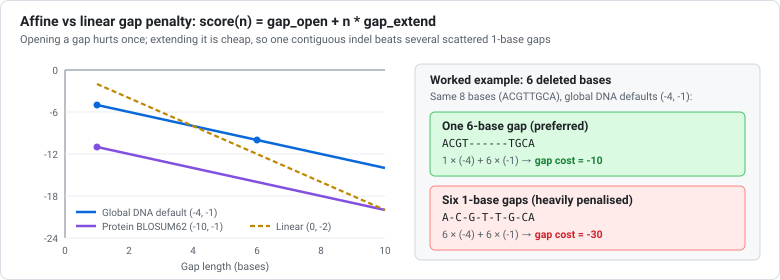

# Choosing scores

[Documentation index](README.md)

When I align DNA or protein sequences, scoring is where most surprises come from. Two alignments of the same sequences can look very different if you change the ratio of match reward to mismatch penalty, or make gap opening too cheap.

Nucleics Align scores a gap of $n$ bases as:

$$\text{gap score}(n) = \text{gap\_open} + n \times \text{gap\_extend}$$

Both `gap_open` and `gap_extend` are normally zero or negative. Setting `gap_open = 0` gives a plain linear gap penalty.

  

Because opening a gap hurts once and extending it is cheap, affine gaps strongly prefer one contiguous 6-base deletion (gap cost `-10` under the global DNA defaults) over six scattered 1-base gaps (`-30`). That matches biology much better than linear gaps.

## Built-in defaults

| Tool | Match | Mismatch | Gap open | Gap extend |
|---|---:|---:|---:|---:|
| `needleman_wunsch` | 1 | -2 | -4 | -1 |
| `smith_waterman` | 2 | -2 | -2 | -1 |

`smith_waterman` starts with a higher match reward (`+2`) and gentler gap open (`-2`) because local alignment only reports regions whose score stays positive.

## DNA and RNA

A practical rule of thumb from the NCBI BLAST+ nucleotide scoring guidance is to raise the mismatch penalty relative to the match reward as your sequences get closer:

- **~99% conserved:** match `1`, mismatch `-3` (ratio `0.33`)
- **~95% conserved:** match `1`, mismatch `-2` (ratio `0.50`, `needleman_wunsch` default)
- **~75% conserved:** match `1`, mismatch `-1` (ratio `1.00`)

For `1 / -2` DNA scoring, here are common `(gap_open, gap_extend)` combinations alongside Nucleics Align's own built-in `-4 / -1` default:

| Open | Extend | Feel |
|---:|---:|---|
| -5 | -2 | Strict: avoids opening gaps unless strongly supported |
| -4 | -1 | `needleman_wunsch` built-in default (stricter affine open) |
| -3 | -1 | Balanced affine |
| -2 | -1 | Gentler affine (same gap values as `smith_waterman`, which uses `2/-2`) |
| -1 | -1 | Permissive: allows frequent indels |
| -2 | -2 | Moderate open, steeper extension |
| -1 | -2 | Cheap open, steep extension |
| 0 | -2 | Linear gap penalty (no open cost) |

Two other useful DNA options:
- `--scoring DNA_HYBRIDIZATION` switches to a built-in hybridisation matrix (with `-10 / -10` gaps).
- `--wildcard N 0` lets ambiguous `N` bases align to anything for score `0` instead of being penalised as a mismatch.

## Proteins

For protein database searches, the NCBI BLAST+ manual gives provisional matrix choices by query length. Nucleics Align bundles those four matrices as `--scoring` presets with its own built-in gap penalties:

| Query length | Matrix | Built-in `--scoring` gaps (`--gapopen`, `--gapextend`) |
|---|---|---|
| < 35 aa | `PAM30` | `-9`, `-1` |
| 35 – 50 aa | `PAM70` | `-10`, `-1` |
| 51 – 85 aa | `BLOSUM80` | `-10`, `-1` |
| > 85 aa | `BLOSUM62` | `-10`, `-1` (`blastp`'s default is `-11`, `-1`) |

Passing `--scoring BLOSUM62` sets both the substitution table and the `-10 / -1` gap penalties automatically (you can override either with `--gapopen` and `--gapextend`). Note one subtle difference from `--substitution_matrix`: the built-in `--scoring` presets quietly score unknown letters with a fallback mismatch penalty (`-4` for `BLOSUM62`, `-17` for `PAM30`), whereas a file loaded with `--substitution_matrix` stops with an error on unlisted letters unless you add `--wildcard` or `--match`/`--mismatch`.

If you need another matrix (Gonnet, NUC.4.4, or other PAM/BLOSUM tables), the full collection in [`scoring/`](../scoring) comes from the [NCBI BLAST matrix archive](https://ftp.ncbi.nlm.nih.gov/blast/matrices/) and loads via `--substitution_matrix <file>`.
