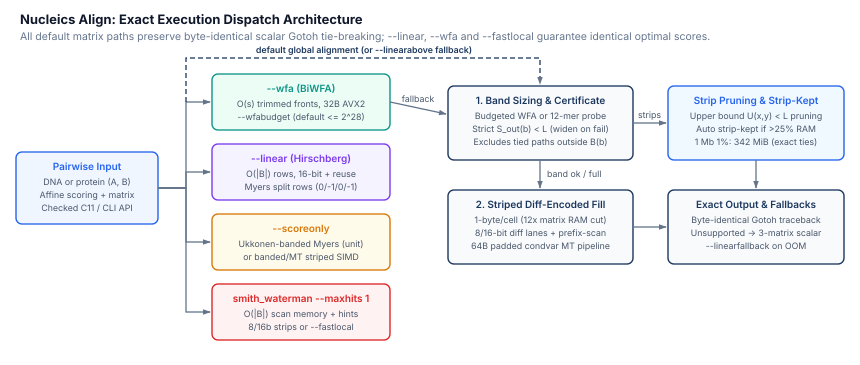
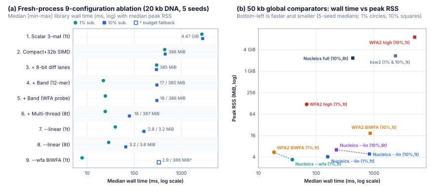
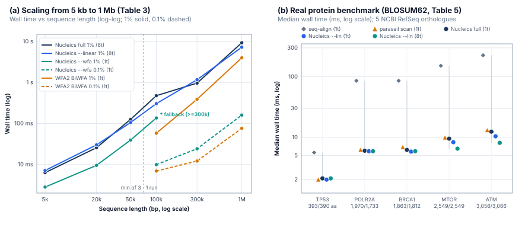

## Abstract

**Background:** Exact pairwise sequence alignment with affine gap penalties (Needleman--Wunsch, Smith--Waterman, Gotoh) remains necessary whenever heuristic mappers may miss optimal alignments or when reproducible scores and deterministic tie-breaking are required. Existing libraries (`parasail`, `ksw2`, `SSW`, `WFA2`, `edlib`, `SeqAn`, `EMBOSS`) each excel in parts of this space, but standalone C tools combining general substitution matrices, single-pair multi-threading, linear-space global alignment at high divergence, and $O(s)$-space bidirectional wavefront alignment remain scarce.

**Results:** I developed Nucleics Align (v1.3.0), a standalone C11 library and CLI suite derived from Isaac Turner's `seq-align`, for exact pairwise alignment of proteins and megabase-scale DNA. Default matrix paths combine 1-byte-per-cell traceback, difference-encoded striped SIMD with prefix-scan carries, a strict out-of-band bound preserving byte-identical scalar Gotoh tie-breaking, strip-level upper-bound pruning, and automatic strip-kept memory fallback; optional `--linear` (Hirschberg/Myers-Miller), `--wfa` (budgeted bidirectional wavefront), `--scoreonly` (Ukkonen-banded Myers for unit costs), and `--fastlocal` modes guarantee the identical optimal score. On native Linux (8-core AMD Ryzen 7 5700G), single-threaded `--linear` is 2.3–15.0x faster than unbanded `ksw2` (128-bit SSE4.1) and 4.9–36x faster than 32-bit `parasail` AVX2 `scan` across 20–50 kb DNA while using 2.8–6.5 MiB (134–674x less RAM than `ksw2` and 392–2,327x less than `parasail`), and 8.8–10.8x faster than `WFA2 BiWFA` on unrelated pairs (up to 36.5x on 8 threads). On 1% substitution DNA, single-threaded `--wfa` aligns 20 kb in 10.5 ms (2.9 MiB), 50 kb in 38.7 ms (3.4 MiB), and 1 Mb at 0.1% in 160.7 ms (11 MiB), beating `WFA2` high-memory mode by 1.8x in 10–36x less RAM, while `WFA2 BiWFA` remains 1.4–2.4x faster in wall time on closely related pairs. On real genomes (8 requested threads), `--wfa` aligns 197 kb Mpox genomes in 8.5 ms (4.2 MiB) and `--linear` aligns 580 kb *Mycoplasma genitalium* chromosomes in 2.31 s (28.9 MiB). On five BLOSUM62 protein orthologues, `--linear` beats `parasail` `striped` in-process by 1.7–3.7x and reduces CLI RAM 3.3–7.6x, while `parasail` `scan` leads in-process by 2.3–3.8x. `edlib` remains faster on 5 of 6 unit-cost edit-distance conditions, and `SSW` remains faster than single-threaded local alignment where scores fit in 16 bits.

**Conclusions:** Nucleics Align brings exact affine-gap global alignment to megabase-scale DNA in megabytes of RAM and provides fast, dependency-free exact DNA and protein alignment on desktop hardware.

**Availability:** Source code, C library, CLI tools, Python 3 and Perl interfaces, and reproducible benchmark harnesses are released under the BSD 3-Clause licence at https://github.com/DanielTillett/nucleics-align.

---

## 1. Introduction

Exact pairwise sequence alignment by dynamic programming has been a core method in bioinformatics since the 1970s. Needleman and Wunsch introduced optimal global alignment [@needleman1970general], Smith and Waterman formulated optimal local alignment [@smith1981identification], and Gotoh reduced affine gap-penalty alignment from cubic to quadratic time using three coupled dynamic programming matrices [@gotoh1982improved]. Under an affine gap model, a contiguous insertion or deletion of $n$ residues scores $g_{\text{open}} + n \cdot g_{\text{extend}}$, penalising gap initiation more heavily than extension so that one contiguous indel is preferred over scattered single-base gaps.

In high-throughput genomics, heuristic seed-and-extend tools such as BLAST/BLAST+ [@altschul1990blast; @camacho2009blastplus] and minimap2 [@li2018minimap2] dominate database search and read mapping because $O(mn)$ dynamic programming is prohibitive across millions of reads or gigabase references. Exact pairwise alignment remains necessary, however, when comparing viral and organelle genomes, validating variants near complex indels, scoring homologous proteins with BLOSUM [@henikoff1992amino] or PAM [@dayhoff1978model] matrices, or establishing ground-truth reference alignments when testing heuristic tools.

Over the past five decades, four main families of exact speed-ups have been developed:

1. **SIMD vectorisation and multi-threading.** Early implementations exploited multimedia instructions along anti-diagonals [@wozniak1997using] or query profiles [@rognes2000sixfold]. Farrar's striped SIMD layout [@farrar2007striped] moved the vertical-gap dependency out of the inner loop into a lazy-F correction pass and underpins `SSW` [@zhao2013ssw; @sswrepo] and `parasail` [@daily2016parasail]. Prefix-scan carry propagation was introduced for GPU Smith-Waterman by Khajeh-Saeed et al. [@khajehsaeed2010acceleration], implemented in `parasail`'s scan kernels [@daily2016parasail], and used inside adaptive SIMD blocks by Block Aligner [@liu2023block]. Suzuki and Kasahara [@suzuki2018introducing] showed that storing vertical and horizontal score differences keeps lane values within 8 or 16 bits regardless of sequence length, an approach used in `ksw2` [@li2018minimap2; @ksw2repo]. The C++ `SeqAn` library [@rahn2018seqan] combines vectorised DP with multi-threading across and within sequence pairs.
2. **Linear-space divide-and-conquer.** Hirschberg [@hirschberg1975linear] and Myers and Miller [@myers1988optimal] reduced the working memory of exact global alignment from $O(mn)$ to linear in sequence length at the cost of roughly twice the arithmetic work, later combined with diagonal banding by Chao et al. [@chao1992aligning]. Many biologists encounter this algorithm via EMBOSS `stretcher` (alongside full-matrix `needle`) [@rice2000emboss].
3. **Output-sensitive and volume-pruning methods.** Fickett [@fickett1984fast] introduced band-doubling with an out-of-band score bound for exact optimal alignment, Ukkonen [@ukkonen1985algorithms] showed that edit distance can be computed in $O(s \cdot \min(m, n))$ time for edit distance $s$, and Spouge [@spouge1989speeding] formalised computational volumes for pruning unreachable lattice states. For affine gaps, the Wavefront Alignment (WFA) algorithm [@marcosola2021fast; @wfa2lib] runs in $O(ns)$ worst-case time and $O(s^2)$ space; Eizenga and Paten (preprint) [@eizenga2022improving] generalised its scoring and analysed an $O(n + s^2)$ expected-time variant under uniform random errors; bidirectional WFA (`BiWFA`) reduces space to $O(s)$ [@marcosola2023optimal]; and `Singletrack` [@lopezvillellas2026singletrack] cuts affine backtrace memory 3x inside `WFA2-lib`. Groot Koerkamp and Ivanov's `A*PA` [@grootkoerkamp2024apa] and `A*PA2` [@grootkoerkamp2024apa2] apply admissible seed heuristics and strip-based computational volumes to unit-cost edit distance.
4. **Bit-vector parallelism.** For unit-cost Levenshtein edit distance, Myers' bit-vector algorithm [@myers1999fast] computes 64 DP cells per machine word using a small constant number of bitwise operations and underlies `edlib` [@sosic2017edlib].

Each existing tool occupies a distinct niche. `edlib` [@sosic2017edlib] is limited to unit-cost edit distance without affine gaps or substitution matrices. `WFA2` and `BiWFA` [@marcosola2021fast; @marcosola2023optimal] are fast on closely related pairs, but their work grows with penalty score $s$ so they slow sharply on divergent or unrelated 20–50 kb pairs, and they do not support arbitrary protein substitution matrices. `parasail` [@daily2016parasail] and `ksw2` [@li2018minimap2] support general scoring well, but run single-threaded per pair and consume gigabytes of RAM in full-matrix traceback modes on 50 kb global alignments. `SSW` [@zhao2013ssw] is fast for local alignment but does not provide global affine-gap alignment. `EMBOSS` `needle` and `stretcher` [@rice2000emboss] are scalar implementations, while `SeqAn` [@rahn2018seqan] is a C++ template library rather than a lightweight standalone C tool.

I started Nucleics Align by forking Isaac Turner's `seq-align` [@turner2017seqalign] for its exact Gotoh formulation, fixed tie-breaking, and minimal C dependency footprint. Its limitation was resource use: on a modern desktop, aligning a single 20 kb DNA pair took ~11 s and 4.5 GiB of RAM, and a 50 kb pair would have required ~28 GiB. Nucleics Align keeps `seq-align`'s exact mathematics and scoring flexibility while integrating all four families of exact speed-ups into one portable C11 library and CLI suite. The engineering rule throughout has been strict: every default optimisation must produce the exact same score and alignment, byte for byte, as this codebase's scalar Gotoh baseline (the few intentional bug fixes relative to the original 2017 `seq-align` are listed in `CHANGELOG.md`).

---

## 2. Implementation

Nucleics Align is written in portable C11 with no external alignment library dependencies (bundling only Isaac Turner's `string_buffer`, `seq_file`, and `sort_r`, plus `zlib` and POSIX threads). It builds on Linux, macOS, and Windows under WSL (native Windows compilers are not supported), and provides three CLI tools (`needleman_wunsch`, `smith_waterman`, `lcs`), a static C library (`libalign.a`), a zero-dependency Python 3 wrapper, and Perl modules.

### 2.1 Execution dispatch and modes

Global alignment in `needleman_wunsch` dispatches according to the requested mode and scoring options:

1. **Score-only (`--scoreonly`):** Invokes the checked linear-space score pass. Under unit-cost scoring (`0 / -1 / 0 / -1`), it first attempts Ukkonen-banded Myers bit-vector alignment [@myers1999fast; @ukkonen1985algorithms] (using a full-width Myers fallback on 1 thread, or handing divergent multi-threaded pairs to multi-threaded striped SIMD). Otherwise, where scoring options are supported, it tries a banded striped SIMD pass and falls back to a full striped or scalar linear pass. On unsupported scoring (such as free terminal gaps or positive gap-open penalties), it falls back to the full global aligner; other errors terminate with an error status.
2. **Explicit linear space (`--linear`):** Calls the checked Hirschberg/Myers-Miller aligner directly (using Myers bit-vector split rows for single-threaded unbanded unit-cost pairs) and exits non-zero on unsupported options or errors.
3. **Default global alignment:** When `--wfa` is enabled, it first attempts budgeted bidirectional wavefront alignment (cap configurable via `--wfabudget <n>`); if `--linearabove <n>` is set and the longer sequence has at least $n$ letters, it attempts linear-space alignment. If either is unsupported or does not complete, execution falls back to the matrix aligner. The matrix aligner uses a compact 1-byte-per-cell traceback fill whenever `opts.striped` is enabled and the scoring options are supported by the striped kernels: it first attempts a short budgeted score-only WFA pass (default budget 16 diagonal updates per letter of `seq_a`) or 12-mer estimate to size an exact band (Section 2.4, skipped immediately on small single-threaded inputs where even the narrowest band cannot pay), falling back to a full difference-encoded matrix fill if banding does not pay, and to the scalar three-matrix fill if `opts.striped` is disabled or scoring options are unsupported by the striped kernels. If `--linearfallback` is enabled and matrix allocation fails or overflows `size_t`, it falls back to linear space (Figure 1).

### 2.2 Compact traceback storage and deterministic tie-breaking

The baseline Gotoh implementation stores three 32-bit score matrices (`MATCH`, `GAP_A`, `GAP_B`), requiring 12 bytes per cell (~4.47 GiB for $20{,}000 \times 20{,}000$ cells). In Nucleics Align, compact mode (default in the CLI whenever `opts.striped` is enabled) packs the three 2-bit predecessor state indicators into one byte per cell while keeping only two score rows in RAM during the forward fill, cutting matrix memory 12-fold. Above 1 MiB, traceback buffers grow by 1.25x rather than power-of-two doubling to avoid over-allocating multi-gigabyte matrices.

Whenever multiple paths tie for the optimal score, traceback in every full-matrix path (scalar matrices, compact traceback bytes, exact bands, strip-kept bands, and difference-encoded lanes) follows the same deterministic rule. In Gotoh traceback, the current matrix state fixes the spatial step (`GAP_A` steps to $(x, y-1)$, `GAP_B` to $(x-1, y)$, `MATCH` to $(x-1, y-1)$), and at that predecessor cell the next state is chosen in strict priority order `GAP_A`, `GAP_B`, `MATCH`. Global alignment starts at $(|A|, |B|)$ using the same state priority; Smith-Waterman always starts in `MATCH` at the highest-scoring cell (breaking ties by lowest end coordinate $x$, then $y$). This priority tends to push gaps toward the right end of runs (e.g., `AAA` vs `AA` gives `AA-`, and `ACCA` vs `ACA` gives `AC-A`). By contrast, `--linear` and `--wfa` always return the identical optimal score but may pick a different equal-scoring alignment due to midpoint or wavefront tie-breaking.

### 2.3 Portable striped SIMD, prefix-scan carries, and narrow/difference-encoded lanes

All striped dynamic-programming kernels use portable GCC/clang vector extensions rather than architecture-specific intrinsics (the wavefront match-extension loop in Section 2.5 uses runtime-dispatched AVX2 intrinsics on x86-64 with a portable 8-byte fallback). On x86-64 Linux, GCC/clang function multi-versioning (`target_clones` for `avx2`, `sse4.1`, and `default` SSE2) compiles all three variants into one portable binary (8-lane 32-bit vectors under GCC; 4-lane under Clang dispatch, as Clang rejects 8-lane vectors inside `target_clones` multi-versioned functions). Building with `NATIVE=1` (`-march=native`) enables 16 × 32-bit AVX-512 lanes where present, and Arm64 builds (including Apple silicon) use NEON automatically. On non-Linux x86-64 builds without `NATIVE=1`, multi-versioning is disabled and the build uses baseline SSE2 (with linear-space passes falling back to scalar code).

The striped fill follows Farrar's layout [@farrar2007striped], precomputing a per-query substitution profile for the active alphabet. Drawing on prefix-scan carry propagation [@khajehsaeed2010acceleration; @daily2016parasail; @liu2023block], Nucleics Align precomputes inter-lane vertical-gap carries in a single scan rather than iterating multi-sweep lazy-F loops across banded rows. To increase lane density without losing exactness:
- **Global full traceback fills** store vertical and horizontal score differences [@suzuki2018introducing], keeping values in 8-bit lanes when the per-step score range fits (including standard DNA scoring) and 16-bit lanes for wider matrices such as BLOSUM62 at any sequence length.
- **Local fills** begin in 8-bit lanes (four times as many lanes as 32-bit vectors) and widen to 16- or 32-bit lanes only if a score threatens to saturate.
- **Linear-space passes** use 16-bit relative score blocks.

### 2.4 Provably exact banding, strip pruning, and strip-kept memory

Let $m = |A|$, $n = |B|$, $D = m - n$, $s_{\max} = \max\big(0, \max_{a,b} S(a,b)\big)$, and assume standard affine gap scoring $g_{\text{open}} + \ell \cdot g_{\text{extend}}$ with fully penalised terminal gaps, non-positive penalties $g_{\text{open}} \le 0$ and $g_{\text{extend}} \le 0$, and $s_{\max} - 2 g_{\text{extend}} > 0$. Extending Fickett's band-doubling bound [@fickett1984fast], before filling a banded global matrix Nucleics Align first attempts a budgeted score-only WFA pass [@marcosola2021fast] (default 16 diagonal updates per letter of $A$); when it finishes, it yields the exact optimal score. Otherwise, a fast 12-mer sampling routine produces a deliberately high heuristic score estimate used solely to decide whether a band is worth trying; the final alignment never depends on that estimate.

Exactness is guaranteed mathematically from the score achieved inside the closed band $B(b) = \{(x, y) : \min(0, D) - b \le x - y \le \max(0, D) + b\}$. Let $S_{\text{out}}(b)$ denote the maximum score of any global path that leaves $B(b)$ (or $-\infty$ if no such path exists). Any global path visiting a cell outside $B(b)$ requires at least $I = |D| + 2(b + 1)$ gap characters and at most $(m + n - I)/2 = \min(m, n) - (b + 1)$ aligned residue pairs; because $g_{\text{open}} \le 0$, $g_{\text{extend}} \le 0$, and $s_{\max} \ge 0$, dropping $g_{\text{open}}$ gives a conservative upper bound satisfied by every path leaving $B(b)$:

$$S_{\text{out}}(b) \le s_{\max}\big(\min(m, n) - (b + 1)\big) + g_{\text{extend}}\big(|D| + 2(b + 1)\big)$$

Consequently, once a banded fill finds a feasible global alignment of score $L$, every path leaving $B(b)$ satisfies the strict inequality $S_{\text{out}}(b) < L$ (excluding both better and tied optimal paths outside $B(b)$) whenever:

$$b \ge \left\lfloor \frac{s_{\max}\min(m, n) + g_{\text{extend}}|D| - L}{s_{\max} - 2 g_{\text{extend}}} \right\rfloor$$

Excluded predecessor cells outside the computed window are set to the DP floor so no cell score inside $B(b)$ is ever overestimated. When this strict inequality holds, every optimal and tied-optimal global path stays within $B(b)$; therefore, at every cell along any optimal traceback, all predecessor states that tie in the full matrix also lie on a tied-optimal global path inside $B(b)$ with their exact full-matrix scores, so the fixed state-priority rule reproduces byte-identical full-matrix traceback. If the bound fails, the band is widened and re-run until the inequality holds, or abandoned for a full matrix fill (which is exact unconditionally).

Inspired by `A*PA2` [@grootkoerkamp2024apa2] and Spouge's computational volumes [@spouge1989speeding], the implementation fills horizontal rectangular strip windows that enclose the active diagonals of $B(b)$. Once a feasible lower bound $L$ is known (from the exact WFA score or from a prior banded pass) and $g_{\text{extend}} < 0$, for each cell $(x, y)$ on the bottom row of a strip with best state score $v = \max(M[x,y], G_A[x,y], G_B[x,y])$ and remaining lengths $r_i = m - x$, $r_j = n - y$, any completion to $(m, n)$ scores at most:

$$U(x, y) = v + s_{\max}\min(r_i, r_j) + g_{\text{extend}}|r_i - r_j|$$

Because $s_{\max} \ge 0$, $U(x, y)$ remains a valid upper bound even when all substitution scores are negative. Cells with $U(x, y) < L$ cannot lie on any optimal or tied-optimal path and are pruned; each surviving cell on diagonal $d = x - y$ can deviate by at most $k = \lfloor (U(x, y) - L) / (-2 g_{\text{extend}}) \rfloor$ diagonals beyond $[\min(d, D), \max(d, D)]$ while still completing to a score $\ge L$ (a conservative bound since each extra diagonal also displaces an aligned pair, which would allow the tighter denominator $s_{\max} - 2 g_{\text{extend}}$). The next strip's column window is the union of surviving reachable intervals intersected with the sequence bounds, preserving every optimal and tied-optimal path. When the estimated band footprint exceeds one quarter of physical RAM (falling back to 1 GiB when physical memory cannot be queried), the aligner switches automatically to strip-kept mode, retaining only strip boundary rows during the forward pass and refilling one strip's traceback bytes at a time during traceback (so `full` memory and strip-kept activation thresholds depend on host physical RAM). On the 62 GiB test host, a 1 Mb, 1% nominal substitution global alignment activates strip-kept mode and runs in 342 MiB while preserving full-matrix tie-breaking.

### 2.5 Budgeted bidirectional wavefront alignment (`--wfa`, `--wfabudget`)

When `--wfa` is requested, Nucleics Align converts affine match/mismatch/gap scoring into non-negative penalty costs [@eizenga2022improving], normalises penalties by $\gcd(p_x, p_o, p_e)$, and advances wavefronts by penalty score [@marcosola2021fast]. For short pairs ($|A| + |B| \le 2{,}048$) or non-progressing endpoint splits, it traces back directly through retained wavefronts (note that a non-progressing endpoint split above 2,048 bases can therefore retain wavefronts beyond the normal bidirectional ring buffer). For all progressing recursive splits, Nucleics Align implements bidirectional wavefront alignment (`BiWFA`) [@marcosola2023optimal] with $O(s)$ auxiliary wavefront state (in addition to $O(|A| + |B|)$ storage for the 32-byte sentinel-padded forward/reversed sequences and output buffers): forward and reverse ring-buffer wavefronts advance alternately until they meet across match or affine gap states (accounting for the shared gap-open charge on $I$--$I$ and $D$--$D$ breakpoints), recursively splitting the problem down to the retained-wavefront base case. Each wavefront step decouples its branch-free interior compute loop (compiled with `target_clones` for AVX2, SSE4.1, and SSE2, using a reusable all-empty null wavefront so empty sources do not disable vectorisation) from its match-extension loop (runtime-dispatched 32-byte AVX2 `pcmpeqb`/`movemask` intrinsics on x86-64, else portable 8-byte word comparison), trims empty leading and trailing diagonals, and skips overlap checks until the sum of forward and reverse furthest offsets reaches $|B|$. To fall back quickly on divergent pairs, the global aligner defaults to capping total diagonal updates at $\min(2^{28},\; 256 \cdot (|A| + |B|))$ (configurable via `--wfabudget <n>`); if scoring does not reduce to one match score, one mismatch score, and standard affine gap penalties, or if the work budget is exhausted, execution falls back to the matrix aligner.

### 2.6 Linear-space global alignment (`--linear`) and banded Myers bit-vector

The `--linear` aligner implements Hirschberg's divide-and-conquer algorithm [@hirschberg1975linear] extended to Gotoh's affine gap model [@myers1988optimal], combined with provably exact banded striped passes [@chao1992aligning; @farrar2007striped], 16-bit relative blocks, two-level intermediate row reuse so child sub-problems skip redundant passes, and lazy SIMD scratch allocation. Working score-row memory is $O(|B|)$ (with constant-factor overhead for row reuse and per-thread buffers), plus $O(|A| + |B|)$ for the returned alignment strings. For single-threaded unbanded unit-cost pairs (`0 / -1 / 0 / -1`), `--linear` computes exact forward and reverse split rows via Myers' bit-vector algorithm.

For `--scoreonly` under unit-cost edit distance (`0 / -1 / 0 / -1`), Nucleics Align dispatches first to Myers' 64-bit word-parallel algorithm [@myers1999fast] wrapped in Ukkonen exponential diagonal banding [@ukkonen1985algorithms], widening the edit-distance threshold geometrically up to $\min(m, n)/4 + |m - n|$ before falling back to full-width Myers (on 1 thread) or multi-threaded striped SIMD (on multiple threads).

### 2.7 Best-hit local alignment (`smith_waterman --maxhits 1` and `--fastlocal`)

When only the single highest-scoring local hit is requested (`--maxhits 1`), Nucleics Align scans forward in $O(|B|)$ memory to locate the optimal end cell and score, then scans in reverse from that cell in $O(|B|)$ memory to locate the start cell. Only the resulting sub-rectangle is filled for traceback, with periodic row checkpoints if the rectangle exceeds $2^{28}$ cells. During checkpointed strip refills, Nucleics Align reuses the precomputed substitution table and selects 8- or 16-bit SIMD lanes whenever the known optimal score fits safely, preserving byte-identical Gotoh traceback. An opt-in `--fastlocal` mode (off by default) locates a jointly-attained optimal start and end pair using forward and reverse scans with lane-width hints, reconstructs the sub-rectangle with BiWFA or linear-space global alignment, and verifies exact optimal local score, span coverage, non-gap endpoints, and strictly positive local prefixes before accepting (falling back to the exact local fill on any mismatch).

### 2.8 Multi-threading, error handling, and verification

By default, the CLI tools use half of the host's logical CPUs (`--threads <n>` overrides this). Large single alignments (exceeding $4 \times 10^6$ cells and 1,024 columns per thread block) split columns into pipelined wavefront blocks across threads, while file batches (`--file`, `--files`) align independent pairs concurrently and emit results in strict input order so output is byte-identical to `--threads 1`. Per-block progress counters are 64-byte cache-line aligned to prevent false sharing, waiters cache the last observed row to avoid redundant atomic loads, progress is published every 16 rows, and synchronisation uses a bounded 512-`pause` spin followed by per-boundary condition-variable waits (with terminal wakeup on abort).

In the C library, every major aligner provides a checked entry point returning an error status instead of calling `exit()`. Continuous integration runs on Linux (x86-64 and Arm64) and macOS with GCC and Clang, including AddressSanitizer and UndefinedBehaviorSanitizer (`SANITIZE=1 make test`), executing the randomised differential test suite comparing every optimised path against the scalar Gotoh baseline (~2.0 million checks), targeted regression tests covering deep BiWFA recursion, budget rejection, Myers word boundaries, and `--fastlocal` (`tests/test_v130.c`), and 63 CLI regression fixtures (75 runs, as 12 batch fixtures run at both 1 and 4 threads).

---

## 3. Results

All main benchmarks were run on a native Linux desktop (AMD Ryzen 7 5700G, 8 cores / 16 logical CPUs, 62 GiB RAM, Pop!_OS 24.04 Linux, GCC 13.3.0, default `make` `-O3` build; CPU frequency governor `powersave`, SMT active, no manual core pinning). The archived benchmark logs `benchmarks/results/pop-os-v1.3.0.txt` and `benchmarks/results/pop-os-v1.3.0-journal.txt` (Nucleics Align v1.3.0, commit `2529b86`) record all measurements for Tables 1–5, including per-seed wall times, median CPU times and peak RSS, local per-seed scores and SSW flags, independent cross-tool CIGAR/alignment re-scoring checks, full SHA-256 digests for all synthetic/protein FASTAs and Nucleics Align CLI binaries, and 12-character SHA-256 prefixes for Table 1 FASTAs. CLI timings include process startup, input parsing, alignment, and output writing (so sub-10 ms runs include ~2–4 ms of process startup overhead); the C library ablation (Table 2) times the alignment call directly via `clock_gettime(CLOCK_MONOTONIC)`. Memory figures report peak resident set size (RSS) from GNU `time -v` in binary MiB/GiB (`1 MiB = 1024^2` bytes; `1 GiB = 1024 MiB`), and CPU times come from GNU `time -v` (10 ms resolution, where `0.00 s` is displayed as `<10 ms`). Unless noted, global DNA runs used `+1` match, `-2` mismatch, `-4` gap open, `-1` gap extend; local DNA runs used `+2 / -2 / -2 / -1`; and protein runs used `--scoring BLOSUM62` (`-10 / -1`). All global modes and comparators in Tables 1–5 were programmatically asserted to return the identical optimal score on every completed pair.

### 3.1 Real biological DNA sequences

I timed six public NCBI RefSeq/GenBank DNA genome pairs spanning mitochondrial genomes, coronaviruses, orthopoxviruses, and whole bacterial chromosomes with 8 requested threads (noting that `--wfa` runs single-threaded; minimum wall time and RSS from that run over 3 runs for pairs $\le 200$ kb, 1 run for *M. genitalium*; reproducible via `benchmarks/real_sequences.sh`; Table 1). Circular mitochondrial and bacterial genomes were aligned as deposited in RefSeq without origin rotation; the 580 kb *M. genitalium* pair serves as a whole-chromosome scaling stress test rather than a rearrangement-aware comparison. Reported sequence identities belong to the `full` traceback and count case-insensitive equal symbols divided by total alignment columns (so `N/N` counts as an identity match under `--pretty`, whereas under default DNA alignment scoring ambiguous bases such as `N` are scored as mismatches).

**Table 1. Performance on real biological DNA genome pairs (`pop-os`, AMD Ryzen 7 5700G, 8 requested threads, v1.3.0 `2529b86`; wall ms / peak MiB from the fastest run).** Global modes used `+1/-2/-4/-1`; `local --maxhits 1` used `+2/-2/-2/-1`. Bold marks the fastest global mode returning a full alignment. `†` = `--wfa` exceeded its work budget and fell back to matrices; `—` = not run.

| Pair (NCBI Accessions) | Lengths | Identity | `full` (ms / MiB) | `--wfa` (ms / MiB) | `--linear` (ms / MiB) | `--scoreonly` (ms / MiB) | `local --maxhits 1` (ms / MiB) | Optimal global score |
|---|---:|---:|---:|---:|---:|---:|---:|---:|
| Human/Neanderthal mtDNA (`NC_012920.1`, `NC_011137.1`) | 16.6 / 16.6 kb | 98.72% | 18.0 / 11.4 | **5.3** / 2.8 | 23.1 / 3.0 | 7.0 / 3.2 | 105.5 / 19.1 | 15,928 |
| Human/Chimp mtDNA (`NC_012920.1`, `NC_001643.1`) | 16.6 / 16.6 kb | 85.19% | **50.3** / 266.3 | 75.7† / 266.5 | 54.7 / 3.7 | 20.9 / 3.6 | 100.4 / 19.0 | 10,632 |
| SARS-CoV-2 Wuhan/Omicron (`NC_045512.2`, `OL672836.1`) | 29.9 / 29.7 kb | 99.03% | 21.8 / 16.1 | **5.4** / 3.0 | 46.9 / 3.5 | 13.1 / 3.4 | 251.5 / 41.9 | 29,240 |
| SARS-CoV-2/SARS-CoV-1 (`NC_045512.2`, `NC_004718.3`) | 29.9 / 29.8 kb | 79.54% | 159.6 / 856.2 | 210.6† / 856.4 | **124.1** / 4.2 | 33.6 / 4.0 | 227.0 / 42.0 | 11,467 |
| Mpox Ref/2022 isolate (`NC_063383.1`, `ON563414.3`) | 197.2 / 197.2 kb | 99.92% | 92.6 / 63.8 | **8.5** / 4.2 | 286.7 / 10.9 | 50.3 / 10.2 | 9,402.6 / 626.0 | 196,823 |
| *M. genitalium* G37/M2288 (`NC_000908.2`, `CP003773.1`) | 580.1 / 579.6 kb | 99.09% | **2,151.5** / 4,430.8 | 2,950.0† / 4,431.3 | 2,305.8 / 28.9 | 590.8 / 27.4 | — | 564,775 |

On closely related viral and mitochondrial genomes, `--wfa` (BiWFA) aligns two 197 kb Mpox genomes (99.92% identity) in 8.5 ms and 4.2 MiB (10.9x faster than `full` while using 4.2 vs 63.8 MiB, and 5.9x faster than `--scoreonly`), SARS-CoV-2 Wuhan vs Omicron (99.03% identity) in 5.4 ms and 3.0 MiB (4.0x faster than `full`), and human vs Neanderthal mtDNA (98.72% identity) in 5.3 ms and 2.8 MiB. On divergent SARS-CoV-2 vs SARS-CoV-1 (79.54% identity), `--linear` is faster than `full` (124.1 ms vs 159.6 ms) while reducing peak RSS 204-fold (4.2 MiB vs 856.2 MiB). On human vs chimp mtDNA (85.19% identity), `--linear` runs in 54.7 ms vs 50.3 ms for `full` while cutting RAM 72-fold (3.7 MiB vs 266.3 MiB). Two 580 kb *M. genitalium* chromosomes (99.09% identity, 575,139 matches, 4,101 mismatches, 1,154 gap columns) align in 2.15 s with `full` (4.33 GiB) or 2.31 s with `--linear` using 28.9 MiB (153-fold less RAM).

### 3.2 Fresh-process nine-configuration ablation

To quantify each layer's runtime and peak RAM without cross-run allocator effects, `benchmarks/ablation.c` timed nine configurations of the C11 library API, each in its own fresh process with GNU `time -v` RSS measurement, across five independently generated 20 kb DNA pairs (`benchmarks/gen_pairs.py`, seeds 1–5, substitution probability $p \in \{1\%, 10\%\}$ with single-base insertions and deletions each at probability $p/5$; Table 2). Rows 1–6 add successive optimisations to the matrix kernel (compact 1-byte traceback requires `opts.striped = true`, so row 2 introduces both together; rows 4 and 5 separate 12-mer band sizing from budgeted score-only WFA sizing); rows 7–9 are alternative linear-space and bidirectional wavefront modes. Every configuration returned the exact same optimal score on every pair.

**Table 2. Fresh-process nine-configuration ablation on 20 kb DNA (`pop-os`, AMD Ryzen 7 5700G, v1.3.0 `2529b86`, 5 independent seeds, C11 library API; median [min–max] wall ms and median peak RSS in MiB).** At 10% substitution, rows 4 and 5 skip banding via the cost check and execute a full 8-bit difference fill plus the sizing probe (`385.4–385.6 MiB`). `†` = `--wfa` hit its work budget and fell back to matrices.

| Configuration | 20 kb, 1% sub. (ms / MiB) | 20 kb, 10% sub. (ms / MiB) |
|---|---:|---:|
| 1. Scalar 3-matrix baseline (1 thr.) | 2,728.8 [2,719.0–2,736.5] / 4,580.2 | 2,828.5 [2,819.4–2,854.0] / 4,580.2 |
| 2. + Compact 1-byte & striped 32-bit SIMD (1 thr.) | 443.4 [440.2–459.3] / 385.8 | 453.1 [428.3–460.0] / 385.8 |
| 3. + Difference-encoded 8-bit lanes (1 thr.) | 298.8 [295.7–299.2] / 385.2 | 296.9 [295.2–299.1] / 385.2 |
| 4. + Certified banding, 12-mer sizing only (1 thr.) | 22.1 [20.1–23.1] / 17.3 | 302.8 [302.4–304.1] / 385.4 |
| 5. + Certified banding, WFA sizing enabled (12-mer fallback, 1 thr.) | 24.3 [22.4–25.3] / 17.6 | 303.4 [301.5–305.6] / 385.6 |
| 6. + Multi-threading (8 thr.) | 24.2 [22.1–24.9] / 17.6 | 78.9 [76.1–86.2] / 386.8 |
| 7. Linear space `--linear` (1 thr.) | 39.6 [38.4–40.5] / 2.8 | 160.9 [142.3–169.2] / 3.2 |
| 8. Linear space `--linear` (8 thr.) | 28.6 [27.9–29.5] / 3.2 | 65.9 [64.1–67.9] / 3.6 |
| 9. Bidirectional wavefront `--wfa` (1 thr.) | 7.8 [7.1–8.8] / 2.9 | 332.6† [330.9–338.8] / 385.8 |

Nucleics Align's scalar 3-matrix library call (2.73–2.83 s, 4,580 MiB) is ~4x faster than original `seq-align`'s CLI run (11.0–11.2 s in Table 4; descriptive comparison across library vs CLI timing), likely reflecting replacement of per-cell `scoring_lookup()` calls with a precomputed substitution table and allocation differences. Compact 1-byte traceback combined with striped 32-bit SIMD cuts peak RAM 11.9-fold (4,580 to 386 MiB) and speeds up the alignment call 6.2x (443–453 ms). Difference-encoded 8-bit lanes add a further 1.48–1.53x speedup (297–299 ms). At 1% substitution, provably exact banding yields a 13.5x jump (298.8 to 22.1 ms, 17.3 MiB) and BiWFA `--wfa` reaches 7.8 ms in 2.9 MiB. In this 20 kb 1% ablation, enabling the budgeted WFA band-sizing probe adds 2.2 ms over 12-mer sizing alone (24.3 vs 22.1 ms) because 12-mer sampling already yields a tight band on uniform-random substitutions, and 8 requested threads barely change that row (24.2 ms) because the narrow banded rectangle stays below the multi-threading threshold; the WFA probe remains default because it provides an exact lower bound for strip pruning on inputs with clustered indels or repeats where 12-mer estimates are loose. At 10% substitution, the band cost check skips banding and adds ~6 ms of probe overhead over the unbanded 8-bit fill (303.4 vs 296.9 ms); 8-thread parallelism adds 3.8x (78.9 ms), and `--linear` reaches 160.9 ms on 1 thread and 65.9 ms on 8 threads in 3.2–3.6 MiB (Figure 2a).

### 3.3 Scaling from 5 kb to 1 Mb on simulated DNA

Simulated DNA pairs from 5 kb to 1 Mb were generated deterministically with `benchmarks/gen_pairs.py` (`seed=11`, nominal substitution probability $p \in \{0.1\%, 1\%, 5\%, 10\%\}$ with single-base insertions and deletions each at probability $p/5$, or unrelated pairs) and timed on `pop-os` (v1.3.0 `2529b86`, 8 requested threads for Nucleics Align, noting that `--wfa` is single-threaded, reproducible via `benchmarks/journal_bench.sh`; Table 3). Standard lengths (5–50 kb) report minimum wall time and median peak RSS over 3 runs; large lengths (100 kb – 1 Mb) are single-run observations (unlike the 5-seed medians in Table 4). Every global mode, including matched-input, matched-scoring single-threaded `WFA2 BiWFA` (`v2.3.5`) runs at 100 kb, 300 kb, and 1 Mb (0.1% and 1%), was programmatically asserted to return the identical optimal score on every completed pair.

**Table 3. Scaling on simulated DNA from 5 kb to 1 Mb (`pop-os`, AMD Ryzen 7 5700G, v1.3.0 `2529b86`; wall ms / peak MiB).** Nucleics Align ran with 8 requested threads (`--wfa` is single-threaded); `WFA2 BiWFA` ran on 1 thread. Standard lengths (5–50 kb): min wall / median RSS of 3 runs; large lengths (100 kb – 1 Mb): 1 run. DNA global modes used `+1/-2/-4/-1`; `local1` (`--maxhits 1 --minscore 1`, 8 threads) used `+2/-2/-2/-1`. Bold marks the fastest Nucleics Align global mode returning a full alignment. `†` = `--wfa` hit its work budget and fell back to matrices; `—` = not run.

| Length | Sub. rate | `full` (ms / MiB) | `--wfa` (ms / MiB) | `--linear` (ms / MiB) | `--scoreonly` (ms / MiB) | `local1` (8t) | `WFA2 BiWFA` (1t) |
|---|---|---:|---:|---:|---:|---:|---:|
| 5 kb | 1% | 6.3 / 4 | **2.8** / 2 | 7.1 / 2 | 3.1 / 2 | 23.5 / 30 | — |
| 5 kb | 10% | 14.1 / 27 | 23.2† / 27 | **11.1** / 3 | 4.8 / 3 | 21.6 / 31 | — |
| 5 kb | unrelated | **12.4** / 27 | 21.0† / 27 | 13.4 / 3 | 4.9 / 2 | 30.5 / 31 | — |
| 20 kb | 1% | 25.6 / 16 | **9.5** / 3 | 30.1 / 3 | 8.7 / 3 | 144.6 / 24 | — |
| 20 kb | 10% | 71.0 / 387 | 100.3† / 387 | **70.1** / 4 | 15.6 / 4 | 124.9 / 24 | — |
| 20 kb | unrelated | **70.3** / 387 | 102.0† / 387 | 76.4 / 4 | 20.1 / 4 | 153.0 / 24 | — |
| 50 kb | 1% | 125.8 / 83 | **39.4** / 3 | 105.4 / 4 | 33.5 / 4 | 618.8 / 87 | — |
| 50 kb | 10% | 420.4 / 2,397 | 498.1† / 2,397 | **226.2** / 7 | 63.2 / 6 | 550.1 / 86 | — |
| 50 kb | unrelated | 402.1 / 2,395 | 474.8† / 2,395 | **277.9** / 7 | 96.8 / 6 | 702.3 / 86 | — |
| 100 kb | 0.1% | 70.9 / 38 | **9.9** / 3 | 211.8 / 7 | 39.1 / 6 | — | 6.9 / 4 |
| 100 kb | 1% | 476.7 / 308 | **136.1** / 4 | 304.8 / 6 | 108.3 / 6 | — | 57.9 / 8 |
| 100 kb | 5% | **453.8** / 1,474 | 627.6† / 1,474 | 482.0 / 9 | 143.2 / 8 | — | — |
| 300 kb | 0.1% | 374.1 / 282 | **24.1** / 5 | 545.5 / 15 | 126.3 / 15 | — | 12.1 / 8 |
| 300 kb | 1% | **969.8** / 2,693 | 1,418.0† / 2,693 | 1,170.1 / 16 | 276.7 / 16 | — | 390.8 / 16 |
| 300 kb | 5% | 3,562.8 / 206 *(strips)* | 4,033.3† / 206 | **2,870.9** / 22 | 1,073.0 / 20 | — | — |
| 1 Mb | 0.1% | 4,041.0 / 3,125 | **160.7** / 11 | 3,183.5 / 46 | 1,072.8 / 44 | — | 76.1 / 16 |
| 1 Mb | 1% | 9,349.3 / 342 *(strips)* | 10,220.5† / 342 | **7,293.5** / 50 | 2,658.4 / 47 | — | 4,009.6 / 45 |
| 1 Mb | 5% | — | — | **95,338.5** / 110 | 58,836.2 / 94 | — | — |

With BiWFA, `--wfa` aligns 50 kb 1% in 39.4 ms / 3 MiB, 100 kb 1% in 136.1 ms / 4 MiB (3.5x faster than `full`, 4 vs 308 MiB), and 1 Mb 0.1% in 160.7 ms / 11 MiB (25.1x faster than `full` at 11 vs 3,125 MiB, and 19.8x faster than `--linear`). Across the four 100 kb to 1 Mb rows where Nucleics `--wfa` completes in BiWFA (0.1% at 100 kb, 300 kb, and 1 Mb, plus 100 kb 1%), `WFA2 BiWFA` is 1.4–2.4x faster in wall time (e.g., 76.1 ms vs 160.7 ms at 1 Mb 0.1%) while Nucleics `--wfa` uses less peak RSS (3–11 MiB vs 4–16 MiB). At 300 kb 1% and 1 Mb 1%, Nucleics `--wfa` exhausts its default $\min(2^{28}, 256(|A|+|B|))$ work budget and falls back to matrices (users can raise this cap via `--wfabudget`), whereas `WFA2 BiWFA` completes both and is faster than every Nucleics mode returning a full alignment (390.8 ms / 16 MiB vs 969.8 ms `full` at 300 kb 1%; 4,009.6 ms / 45 MiB vs 7,293.5 ms / 50 MiB `--linear` at 1 Mb 1%, while Nucleics `--scoreonly` finishes in 276.7 ms and 2,658.4 ms). On longer divergent pairs, `full` automatically activates strip-kept mode (206 MiB at 300 kb 5%; 342 MiB at 1 Mb 1%) while preserving full-matrix tie-breaking, and `--linear` keeps peak RSS at 46–110 MiB even at 1 Mb and 5% nominal substitution rate (95.3 s; Figure 3a).

### 3.4 Reproducible 5-seed comparison with existing exact aligners

Using the self-contained harnesses `benchmarks/compare_harness.sh` and `benchmarks/journal_v130_extra.sh` on native Linux `pop-os`, I compared Nucleics Align (v1.3.0, default `make` `-O3`, portable AVX2/SSE4.1/SSE2 dispatch) against clean pinned builds of original `seq-align` (`dc41988`, default `make`) [@turner2017seqalign], `ksw2` (`289609b`, `gcc -O3 -msse4.1`, 128-bit SSE4.1 `ksw_extz2_sse` with `w=-1`, `zdrop=-1`, `flag=0` for unbanded exact score + CIGAR, plus a banded `ksw2` control given Nucleics Align's exact certified band width on 1% pairs) [@li2018minimap2; @ksw2repo], `parasail` (`v2.6.2` / `600fb26`, `gcc -O3 -mavx2`, 32-bit `nw_trace_scan_avx2_256_32` for global DNA and 32-bit `sw_trace_striped_avx2_256_32` for exact local DNA without 16-bit saturation) [@daily2016parasail], `WFA2-lib` (`v2.3.5` / `cf3eb92`, built via `make BUILD_EXAMPLES=0 BUILD_TOOLS=0 all` with `-O3 -march=native`, exact high-memory and ultralow `BiWFA` modes with `wf_heuristic_none`, `compute_alignment` CIGAR, affine penalties `match=0, mismatch=6, gap_open=8, gap_extend=3` mapped back via `score = (|A|+|B|-penalty)/2`) [@marcosola2021fast; @marcosola2023optimal; @wfa2lib], `edlib` (`v1.2.7` / `ec2310e`, `g++ -O3`, `EDLIB_MODE_NW`, `EDLIB_TASK_DISTANCE`, unit-cost global edit distance) [@sosic2017edlib], and `SSW` (`a66636b`, `gcc -O3`, `ssw_align` with `+2/-2/-2/-1` local scoring, score + CIGAR) [@zhao2013ssw; @sswrepo]. Note that the timed CLI runs for Nucleics Align print full gapped alignment strings whereas the comparator wrappers emit score and CIGAR length (so CLI timings reflect end-to-end wrapper execution rather than identical serialisation). I timed all tools across five independently generated deterministic DNA pairs per condition (`benchmarks/gen_pairs.py`, seeds 1–5, mutually exclusive per-base substitution probability $p$ and single-base insertion/deletion probabilities $p/5$; 1 seed for original `seq-align` in all three 20 kb conditions and for `WFA2 high` on 20 kb unrelated; `WFA2 high` on 50 kb unrelated was skipped due to multi-gigabyte memory demand). Every global and unit-cost tool returned the exact same optimal score on every completed pair. For local alignment, Nucleics Align used `--minscore 1` so it reported the optimal hit on every seed, agreeing in score with 32-bit `parasail` on all 15 pairs and with `SSW` on all 10% and unrelated seeds (while `SSW` saturated at 32,767 on all five 1% seeds; Table 4).

**Table 4. Reproducible 5-seed comparator benchmark (`pop-os`, AMD Ryzen 7 5700G, native Linux, v1.3.0; median wall ms [min–max] and median CPU ms in parentheses; CPU not recorded for unit-cost rows).** Bold marks the lowest displayed wall time per column among comparable exact runs within each block. `†` = `--wfa` hit its work budget and fell back. `§` = 1 seed only. `*` = `SSW` saturated at `INT16_MAX = 32,767` on all 5 seeds (true optimal scores 38,776–38,940; `ssw_flag = [1, 1, 0, 1, 0]`).

| Benchmark & tool | 1% sub. (ms) | 10% sub. (ms) | Unrelated (ms) | Median RSS (1% / 10% / rand) |
|---|---|---|---|---|
| **Global affine, 20 kb (`+1/-2/-4/-1`)** | | | | |
| `seq-align` (`dc41988`, 1 thr.)§ | 10,976 (10,960) | 11,225 (11,210) | 12,164 (12,150) | 4,577 / 4,586 / 4,580 MiB |
| Nucleics Align (default, 1 thr.) | 26.8 [24.3–27.0] (20) | 251.0 [249.7–252.4] (240) | 224.3 [221.9–229.3] (220) | 17.7 / 385.8 / 385.7 MiB |
| Nucleics Align `--linear` (1 thr.) | 41.5 [41.1–42.5] (40) | 164.6 [145.7–170.1] (160) | 187.5 [172.2–197.9] (180) | 2.8 / 3.2 / 3.9 MiB |
| Nucleics Align `--wfa` (1 thr.) | 10.5 [9.5–10.9] (<10) | 278.8† [278.0–280.6] (270) | 253.1† [250.5–257.3] (240) | 2.9 / 385.8 / 385.7 MiB |
| Nucleics Align (default, 8 thr.) | 26.6 [24.2–27.5] (20) | 76.2 [70.0–82.1] (440) | 74.0 [72.1–84.6] (440) | 17.5 / 387.0 / 386.9 MiB |
| Nucleics Align `--linear` (8 thr.) | 30.6 [30.5–31.7] (40) | **67.2** [65.7–68.3] (140) | **72.6** [72.1–74.1] (200) | 3.2 / 3.7 / 4.3 MiB |
| `ksw2` (`289609b`, unbanded SSE4.1, 1 thr.) | 413.7 [411.7–421.8] (400) | 419.4 [415.3–422.6] (410) | 424.9 [422.2–432.2] (420) | 523.4 / 523.4 / 523.2 MiB |
| `ksw2` (banded at certified $b$, 1 thr.) | 15.3 [14.5–15.6] (<10) | — | — | 16.4 / — / — MiB |
| `parasail` (`v2.6.2`, scan32 AVX2, 1 thr.) | 909.0 [893.2–931.8] (890) | 909.8 [908.2–916.8] (900) | 927.7 [914.2–953.1] (920) | 1,527 / 1,528 / 1,528 MiB |
| `WFA2` (`v2.3.5` high, 1 thr.) | 19.0 [16.8–19.6] (10) | 873.8 [851.4–970.2] (860) | 9,440§ (9,430) | 29.1 / 1,491 / 17,029 MiB |
| `WFA2 BiWFA` (`v2.3.5`, 1 thr.) | **6.5** [6.2–6.8] (<10) | 155.9 [153.8–170.4] (150) | 1,652.7 [1,634–1,678] (1,640) | 4.1 / 9.8 / 23.9 MiB |
| **Global affine, 50 kb (`+1/-2/-4/-1`)** | | | | |
| Nucleics Align (default, 1 thr.) | 117.8 [112.9–122.1] (110) | 1,506.5 [1,497–1,514] (1,490) | 1,354.5 [1,343–1,375] (1,340) | 83.5 / 2,390 / 2,391 MiB |
| Nucleics Align `--linear` (1 thr.) | 158.5 [154.7–164.5] (150) | 835.4 [826.3–915.6] (830) | 952.6 [945.6–1,046] (940) | 4.1 / 4.9 / 6.5 MiB |
| Nucleics Align `--wfa` (1 thr.) | 38.7 [35.3–43.6] (30) | 1,611.3† [1,580–1,639] (1,600) | 1,421.9† [1,417–1,436] (1,410) | 3.4 / 2,390 / 2,392 MiB |
| Nucleics Align (default, 8 thr.) | 118.0 [111.4–121.4] (110) | 429.8 [415.2–434.7] (2,530) | 409.5 [400.9–414.0] (2,410) | 83.6 / 2,393 / 2,395 MiB |
| Nucleics Align `--linear` (8 thr.) | 105.1 [102.7–107.6] (160) | **224.0** [221.5–229.7] (810) | **280.9** [270.8–288.1] (1,150) | 4.5 / 6.4 / 7.8 MiB |
| `ksw2` (`289609b`, unbanded SSE4.1, 1 thr.) | 2,370.2 [2,354–2,383] (2,360) | 2,357.9 [2,337–2,361] (2,340) | 2,334.5 [2,317–2,351] (2,320) | 2,762 / 2,760 / 2,762 MiB |
| `ksw2` (banded at certified $b$, 1 thr.) | 79.3 [76.9–84.1] (70) | — | — | 87.9 / — / — MiB |
| `parasail` (`v2.6.2`, scan32 AVX2, 1 thr.) | 5,748.6 [5,628–5,918] (5,740) | 5,979.6 [5,781–6,242] (5,970) | 5,906.4 [5,700–6,149] (5,890) | 9,541 / 9,535 / 9,540 MiB |
| `WFA2` (`v2.3.5` high, 1 thr.) | 68.6 [63.3–77.9] (60) | 5,069.8 [4,989–5,336] (5,050) | — | 121.0 / 9,225 / — MiB |
| `WFA2 BiWFA` (`v2.3.5`, 1 thr.) | **18.6** [17.1–20.4] (10) | 860.5 [849.3–903.8] (850) | 10,254.6 [10,070–10,928] (10,240) | 5.5 / 18.6 / 44.6 MiB |
| **Unit-cost edit distance, 20 kb / 50 kb (`0/-1/0/-1`, score-only, 1 thr.)** | | | | |
| Nucleics Align `--scoreonly` (20 kb) | **3.4** [3.2–3.9] | 10.4 [10.1–10.5] | 40.5 [40.4–40.9] | 2.4 / 2.4 / 2.4 MiB |
| `edlib` (`v1.2.7`, 20 kb) | **3.4** [3.3–3.8] | **6.4** [6.0–6.6] | **17.9** [17.5–18.4] | 3.9 / 4.0 / 3.9 MiB |
| Nucleics Align `--scoreonly` (50 kb) | 7.5 [7.1–7.7] | 42.2 [41.4–42.4] | 221.6 [220.2–227.0] | 2.7 / 2.7 / 2.7 MiB |
| `edlib` (`v1.2.7`, 50 kb) | **6.0** [5.5–6.3] | **18.5** [18.3–18.8] | **72.5** [72.2–73.4] | 4.1 / 4.0 / 4.1 MiB |
| **Best local hit, 20 kb (`--maxhits 1 --minscore 1`, `+2/-2/-2/-1`)** | | | | |
| Nucleics Align default (1 thr.) | 482.7 [482.0–486.6] (470) | 355.7 [351.9–357.2] (340) | 610.8 [608.5–623.8] (600) | 22.1 / 21.7 / 21.3 MiB |
| Nucleics Align `--fastlocal` (1 thr.) | 509.2 [508.2–514.6] (500) | 488.6 [481.0–491.5] (480) | 471.9 [464.1–479.6] (460) | 3.6 / 3.8 / 4.4 MiB |
| Nucleics Align default (8 thr.) | 142.9 [139.7–160.1] (600) | 127.5 [121.7–129.5] (500) | 156.1 [150.7–164.5] (790) | 24.3 / 23.8 / 24.0 MiB |
| Nucleics Align `--fastlocal` (8 thr.) | **91.7** [84.1–102.9] (570) | 160.5 [152.5–161.9] (600) | **134.8** [130.0–140.3] (540) | 6.3 / 6.3 / 6.6 MiB |
| `parasail` (`v2.6.2`, sw32 AVX2, 1 thr.) | 1,399.5 [1,382–1,447] (1,380) | 1,044.9 [1,041–1,082] (1,030) | 991.0 [987.9–1,025] (980) | 1,528 / 1,528 / 1,528 MiB |
| `SSW` (`a66636b`, 1 thr.) | 2,171.5* [193.9–2,216.6] (2,160) | **126.2** [125.9–141.7] (120) | 525.3 [281.4–804.9] (520) | 884.4 / 7.7 / 95.6 MiB |

In matched single-thread runs, Nucleics Align `--linear` is 2.3–15.0x faster than unbanded `ksw2` (which runs 128-bit SSE4.1, whereas Nucleics Align dispatches 256-bit AVX2) across all six 20 kb and 50 kb conditions using 134–674x less RAM, and 4.9–36x faster than 32-bit `parasail` AVX2 `scan` using 392–2,327x less RAM (`parasail` consumes 1.5 GiB at 20 kb and 9.3 GiB at 50 kb). Giving `ksw2` Nucleics Align's exact certified band widths externally (`b = 334–364` at 20 kb 1% and `829–926` at 50 kb 1%) isolates the effect of banding: banded `ksw2` drops to 15.3 ms (16.4 MiB) and 79.3 ms (87.9 MiB), faster than Nucleics' banded matrix fill (`26.8` and `117.8 ms`, which must also discover and certify the band and emit gapped strings) while remaining 1.5–2.0x slower than single-threaded Nucleics `--wfa` (`10.5 ms / 2.9 MiB` and `38.7 ms / 3.4 MiB`). Single-threaded `--wfa` beats `WFA2` high-memory mode by 1.8x in 10–36x less RAM (and uses less RAM than `WFA2 BiWFA` at 4.1–5.5 MiB), while `WFA2 BiWFA` remains 1.6–2.1x faster in wall time at 1% substitution (6.5 and 18.6 ms). At high divergence on 1 thread, `WFA2 BiWFA` is slightly faster than `--linear` at 20 kb 10% (155.9 vs 164.6 ms), the two are similar at 50 kb 10% (835.4 vs 860.5 ms), and `--linear` is 8.8x faster on 20 kb unrelated (187.5 vs 1,652.7 ms) and 10.8x faster on 50 kb unrelated (952.6 vs 10,254.6 ms, 6.5 vs 44.6 MiB). On 8 threads, `--linear` reaches 224.0 ms (50 kb 10%) and 280.9 ms (50 kb unrelated, 36.5x faster than `WFA2 BiWFA`), and 8-thread `full` CPU time on 50 kb unrelated (2,410 ms) stays within 4% of 1-thread `ksw2` (2,320 ms) while running 5.7x faster in wall time.

On unit-cost edit distance (`--scoreonly` vs `edlib v1.2.7`), both tools agreed on every score across all 30 pairs (6 conditions × 5 seeds). Ukkonen-banded Myers ties `edlib` at 20 kb 1% (3.39 vs 3.41 ms, using 2.4 vs 3.9 MiB), while `edlib` is 1.25–3.1x faster across the remaining five conditions (including 5.97 vs 7.45 ms at 50 kb 1%). To verify traceback validity beyond reported scores, `benchmarks/journal_bench.sh` and `benchmarks/journal_extra.py` independently re-scored the returned alignments or CIGAR strings and verified exact input span coverage on 20 kb (`1%`, `10%`, and `rand`, seed 1) across all five global tools (`full`, `--linear`, `--wfa`, `ksw2`, and `WFA2 BiWFA`), confirming exact agreement (`18,934`, `10,215`, and `-13,508`), as well as deep BiWFA recursion on 100 kb 1% (`94,810`) and 1 Mb 0.1% (`994,784`) for both Nucleics `--wfa` and `WFA2 BiWFA`.

On 20 kb local alignment (`--maxhits 1 --minscore 1`), Nucleics Align default, `--fastlocal`, and 32-bit `parasail` agreed in score on all 15 pairs, and agreed with `SSW` on all 10% (28,686–29,521) and unrelated pairs (3,241–3,332) with `ssw_flag = 0`. Compared against 32-bit `parasail` (1,399.5 / 1,044.9 / 991.0 ms, 1,528 MiB), single-threaded Nucleics default is 1.6–2.9x faster using 70x less RAM (21.3–22.1 MiB), and 8-thread `--fastlocal` reaches 91.7 ms on 1% (15.3x faster than `parasail`, 1.56x faster than default 8-thread, and 3.9x less RAM at 6.3 MiB) and 134.8 ms on unrelated (6.6 MiB). Against 16-bit `SSW` on 1 thread, `SSW` is faster on both non-saturated conditions (126.2 vs 355.7 ms at 10%; 525.3 vs 610.8 ms on unrelated, where `--fastlocal` 1t reaches 471.9 ms in 4.4 MiB); on 8 threads, Nucleics default matches `SSW` at 10% (127.5 vs 126.2 ms) and `--fastlocal` is 3.9x faster on unrelated pairs (134.8 vs 525.3 ms). At 1% substitution (`*`), the true optimal local score (38,776–38,940) exceeds SSW's signed 16-bit limit (`INT16_MAX = 32,767`; SSW has no 32-bit path, so all five seeds saturate at 32,767 and three of five seeds return `ssw_flag = 1`); those saturated SSW rows are reported as a failure-mode observation rather than an exact comparison.

### 3.5 Multi-pair real protein benchmark (BLOSUM62)

Because wavefront aligners such as `WFA2` and edit-distance aligners such as `edlib` do not support arbitrary protein substitution matrices, I benchmarked five real NCBI RefSeq orthologue pairs spanning 390 to 3,066 amino acids and 49.1% to 98.9% sequence identity (column identity of the default global traceback) under `BLOSUM62` (`-10 / -1`) comparing original `seq-align` (`dc41988`) and pinned `parasail` (`v2.6.2` / `600fb26`, `gcc -O3 -mavx2`, both `nw_trace_scan_avx2_256_16` and `nw_trace_striped_avx2_256_16`, with `open=11, extend=1` matching Gotoh `-10/-1`, full CIGAR traceback) [@daily2016parasail] against Nucleics Align (`benchmarks/protein_bench.sh`, `benchmarks/journal_bench.sh`, `benchmarks/journal_extra.py`, and `benchmarks/journal_v130_extra.sh`; Table 5, Figure 3b). Every global tool returned the identical optimal score on every pair, and independent BLOSUM62 re-scoring of the returned alignments/CIGARs for `parasail` `striped`, `full`, and `--linear` confirmed exact scores and input span coverage across all five pairs.

**Table 5. Real protein orthologue benchmark under BLOSUM62 (`-10/-1`, `pop-os`, AMD Ryzen 7 5700G, v1.3.0; median CLI wall ms / peak MiB over 3 runs; `--scoreonly` and `local1` ran with 8 requested threads).** `parasail` CLI reports `nw_trace_scan_avx2_256_16` (`nw_trace_striped_avx2_256_16` took 2.4, 13.8, 13.0, 23.9, and 33.5 ms). Bold marks the lowest displayed CLI time among global modes returning a full alignment (ties at 0.1 ms precision are both bolded).

| Protein pair (NCBI Accessions) | Len. (aa) | Id. | `seq-align` (1t) | `parasail` scan (1t) | `full` (1t) | `full` (8t) | `--linear` (1t) | `--linear` (8t) | `--scoreonly` | `local1` | Global score |
|---|---:|---:|---:|---:|---:|---:|---:|---:|---:|---:|---:|
| Human/Mouse TP53 (`NP_000537.3`, `NP_035770.2`) | 393/390 | 76.77% | 5.6 / 3.4 | **2.0** / 2.0 | 2.1 / 2.3 | 2.1 / 2.5 | **2.0** / 2.4 | 2.1 / 2.4 | 1.9 / 2.4 | 2.3 / 2.6 | 1,540 |
| Human POLR2A / Yeast Rpo21 (`NP_000928.1`, `NP_010141.1`) | 1,970/1,733 | 49.09% | 85.9 / 40.6 | 6.2 / 8.3 | 6.0 / 6.4 | 6.3 / 6.4 | **5.9** / 2.5 | **5.9** / 2.6 | 4.3 / 2.5 | 8.1 / 7.0 | 4,630 |
| Human/Mouse BRCA1 (`NP_009225.1`, `NP_033894.3`) | 1,863/1,812 | 55.76% | 85.8 / 40.3 | 6.9 / 8.2 | 6.2 / 6.4 | 6.8 / 6.5 | **5.8** / 2.5 | 5.9 / 2.6 | 4.0 / 2.5 | 7.4 / 7.0 | 4,827 |
| Human/Mouse MTOR (`NP_004949.1`, `NP_064393.2`) | 2,549/2,549 | 98.94% | 152.1 / 76.0 | 9.9 / 14.2 | 9.5 / 10.4 | 9.3 / 10.4 | 8.3 / 2.5 | **6.5** / 2.5 | 3.9 / 2.5 | 12.4 / 11.5 | 13,042 |
| Human/Mouse ATM (`NP_000042.3`, `NP_031525.2`) | 3,056/3,066 | 83.84% | 226.5 / 108.9 | 13.1 / 19.7 | 12.4 / 12.5 | 12.1 / 12.5 | 10.4 / 2.6 | **8.1** / 2.7 | 4.7 / 2.5 | 16.4 / 14.6 | 13,333 |

In end-to-end CLI invocation on the four large proteins, single-threaded `--linear` is faster than `parasail` AVX2 `scan` (5.9 vs 6.2 ms on POLR2A, 5.8 vs 6.9 ms on BRCA1, 8.3 vs 9.9 ms on MTOR, and 10.4 vs 13.1 ms on ATM; up to 1.26x) while using 3.3–7.6x less RAM (2.5–2.6 vs 8.2–19.7 MiB), and 8-thread `--linear` reaches 6.5 ms on MTOR and 8.1 ms on ATM (27.9x faster and 40x less RAM than original `seq-align`). Because single-pair CLI timings of 2–13 ms include process startup and initial page-faulting of `parasail`'s full trace table, I also measured pure in-process library calls (15 warm repetitions per protein, zero startup overhead, full traceback/CIGAR decode; `benchmarks/results/pop-os-v1.3.0-extra.txt`). In-process, `parasail` `scan` is 2.3–3.8x faster than Nucleics `--linear 1t` (TP53 0.063 vs 0.236 ms; POLR2A 1.039 vs 2.984 ms; BRCA1 1.100 vs 2.886 ms; MTOR 1.484 vs 4.557 ms; ATM 2.626 vs 6.024 ms), whereas Nucleics `--linear 1t` is 1.7–3.7x faster than `parasail` `striped` (0.396, 8.462, 7.711, 15.093, and 22.134 ms) and Nucleics `full 1t` (0.213, 4.163, 4.064, 7.382, and 10.491 ms) is 1.9–2.1x faster than `parasail` `striped`.

### 3.6 Thread scaling and long-indel workloads

To quantify multi-threaded scaling and sensitivity to block indels, I ran two additional experiments (`benchmarks/journal_v130_extra.sh`, archived in `benchmarks/results/pop-os-v1.3.0-extra.txt`). Across 1, 2, 4, 8, and 16 threads on 50 kb 10% (seed 1, median of 3 runs), `full` scales from 1,508.2 ms (1t) to 828.4 ms (2t, 1.82x), 506.0 ms (4t, 2.98x), 424.4 ms (8t, 3.55x), and 409.5 ms (16t, 3.68x); `--linear` scales from 831.3 ms (1t) to 458.0 ms (2t, 1.81x), 313.6 ms (4t, 2.65x), 222.1 ms (8t, 3.74x, with 800 ms total CPU vs 820 ms at 1t), and 217.8 ms (16t, 3.82x). Scaling plateaus above 8 threads because the host has 8 physical cores (16 SMT threads) and pipelined wavefront synchronisation limits efficiency (~44–47% at 8 threads). On three unequal-length long-indel pairs (20 kb vs 18.9–19.3 kb, 1% substitutions plus sixteen 50–200 bp block deletions and insertions), every tool returned the identical optimal score (`16,763`, `15,923`, `16,075`): `WFA2 BiWFA` led at 33.4 ms (6.8 MiB), Nucleics `--linear` took 51.8 ms on 8 threads (3.2 MiB) and 83.9 ms on 1 thread (3.0 MiB), Nucleics `full 1t` stayed banded at 83.6 ms (41.8 MiB), Nucleics `--wfa 1t` hit its budget due to the cumulative block-indel penalty and fell back cleanly (116.3 ms / 41.8 MiB), unbanded `ksw2` took 395.2 ms (496.0 MiB), and 32-bit `parasail` `scan` took 858.3 ms (1,450.6 MiB).

---

## 4. Discussion

Exact pairwise alignment has often forced a choice between general-purpose DP libraries that are slow and memory-hungry on long sequences, and output-sensitive wavefront aligners that are fast on near-identical inputs but degrade sharply on divergent ones. Nucleics Align combines compact traceback storage, difference-encoded striped SIMD with prefix-scan carry propagation, provably exact strip banding, Hirschberg/Myers-Miller linear space, and bidirectional WFA with $O(s)$ wavefront state inside one portable C11 codebase, covering kilobase proteins and viral genomes up to megabase DNA pairs with clear speed-versus-memory trade-offs.

### Novelty and engineering contributions

Nucleics Align builds on established algorithmic foundations [@gotoh1982improved; @hirschberg1975linear; @fickett1984fast; @myers1988optimal; @farrar2007striped; @suzuki2018introducing; @marcosola2021fast; @marcosola2023optimal; @myers1999fast; @grootkoerkamp2024apa2]. Its primary contributions are engineering and systems-level: (1) extending Fickett's out-of-band bound [@fickett1984fast] with a strict inequality (Section 2.4) that excludes tied optimal paths outside the band, combined with strip-level upper-bound pruning and automatic strip-kept memory fallback so full-matrix Gotoh tie-breaking is preserved byte-for-byte even when a band would otherwise exceed RAM; and (2) bringing all four exact speed-up families together with portable multi-versioned SIMD, cache-line-padded condition-variable single-pair multi-threading, and full general substitution-matrix support inside a zero-external-alignment-dependency C11 library and CLI suite.

Nucleics Align is not a replacement for seed-and-extend read mappers such as `minimap2` [@li2018minimap2] or database search tools such as `BLAST+` [@camacho2009blastplus], nor for `edlib` [@sosic2017edlib] when only unit-cost edit distance is needed (Table 4), nor for in-process `parasail` `scan` on short proteins when full-matrix memory is acceptable (Section 3.5). It targets workflows that require exact affine-gap global, overlap, or local alignment, including custom substitution matrices, wildcards, and fixed tie-breaking, from both the command line and C, Python, or Perl. Recent advances such as `Singletrack` [@lopezvillellas2026singletrack] inside `WFA2-lib` (which cuts affine backtrace storage 3x in its demonstrated configuration) and GPU-accelerated `WFA-GPU` [@aguadopuig2023wfagpu] remain complementary for wavefront-dominated and batch GPU workloads.

### Limitations and trade-offs

1. **Multi-threaded efficiency and CPU overhead:** On 8 physical cores, single-pair wavefront parallelism achieves 3.4–3.7x wall-time speedup (~44–47% efficiency) and plateaus at 16 SMT threads (Section 3.6). Bounded 512-`pause` spins plus condition-variable waits keep 8-thread `full` CPU time on 50 kb unrelated pairs (2.41 s) within 4% of 1-thread `ksw2` (2.32 s), while `--linear` on 8 threads uses less than half `ksw2`'s CPU time (0.80–1.15 s vs 2.32–2.34 s), and `--threads 1` eliminates synchronisation overhead on busy multi-job servers.
2. **Local alignment remains $O(mn)$ in time:** Because `smith_waterman --maxhits 1` uses neither banding nor WFA during the forward and reverse scans, long similar local pairs remain quadratic in time (e.g., 9.4 s and 626 MiB on the 197 kb Mpox pair vs 8.5 ms for global `--wfa`), and on 1 thread `SSW` remains faster where scores fit in 16 bits. The opt-in `--fastlocal` flag cuts local peak RSS 3.6–6x and accelerates 8-thread 20 kb 1% (91.7 vs 142.9 ms) and unrelated (134.8 vs 156.1 ms) runs via BiWFA or Hirschberg sub-rectangle reconstruction, but still requires $O(mn)$ endpoint scans.
3. **WFA crossover and scoring scope:** `--wfa` applies only when scoring reduces to one match score, one mismatch score, and standard affine gap penalties. Although BiWFA aligns 50 kb 1% (39.4 ms / 3 MiB), 100 kb 1% (136.1 ms / 4 MiB), and 1 Mb 0.1% (160.7 ms / 11 MiB) in megabytes of RAM, it exhausts its default $\min(2^{28}, 256(|A|+|B|))$ work budget on divergent ($\ge 5\%$), unrelated, or heavy block-indel pairs as well as 1% pairs from 300 kb upward (unless raised with `--wfabudget`) and falls back to the matrix aligner; it therefore remains opt-in.
4. **Memory vs tie-breaking and host-dependent strip-kept switching:** Full compact alignment on 580 kb *M. genitalium* still uses 4.33 GiB, and automatic strip-kept activation depends on host physical RAM (25% of RAM), so hosts with less RAM switch to strip-kept mode earlier. `--linear` and `--wfa` avoid large matrix allocations while returning the identical optimal score, but may select a different equal-scoring alignment when ties exist.
5. **Single-piece affine gaps, comparator scope, and single-host benchmarking:** Nucleics Align implements Gotoh's single-piece affine gap model rather than the dual-affine convex gap cost used by `minimap2`/`ksw2` [@li2018minimap2]. Benchmarks were measured on one x86-64 Zen 3 host under the default `powersave` governor; AVX-512 (`NATIVE=1`) and Arm64 NEON paths are verified in CI but not timed here, and C++ `SeqAn` and Rust `A*PA2` (unit-cost edit distance) were outside the C comparator harness.

### Future work

Two planned extensions build directly on the current architecture: dual-piece convex affine gap penalties (matching `minimap2`/`ksw2` long-indel scoring) and exposing `--wfa`, `--wfabudget`, `--linearabove`, and `--fastlocal` in the Python wrapper.

---

## 5. Availability, acknowledgements, and declarations

- **Code and data availability:** Nucleics Align is released under the BSD 3-Clause licence at https://github.com/DanielTillett/nucleics-align (citation metadata in `CITATION.cff`; a versioned release tag and Zenodo archive DOI will be minted when this manuscript is posted). All real biological sequences in Tables 1 and 5 are publicly available from NCBI RefSeq/GenBank under the listed accessions and can be reproduced with `benchmarks/real_sequences.sh` and `benchmarks/protein_bench.sh`; the ablation, 5-seed comparator, scaling, in-process protein, thread-scaling, and long-indel suites are reproduced by `benchmarks/ablation.c`, `benchmarks/gen_pairs.py`, `benchmarks/compare_harness.sh`, `benchmarks/journal_bench.sh`, `benchmarks/journal_extra.py`, and `benchmarks/journal_v130_extra.sh`, with raw logs archived in `benchmarks/results/pop-os-v1.3.0.txt`, `benchmarks/results/pop-os-v1.3.0-journal.txt`, and `benchmarks/results/pop-os-v1.3.0-extra.txt`.
- **Acknowledgements:** Nucleics Align is derived from Isaac Turner's `seq-align` (Unlicense) and bundles his `string_buffer` (CC0 1.0), `seq_file` (public domain), and `sort_r` (public domain) libraries. Substitution matrices in `scoring/` are from the NCBI BLAST matrix archive.
- **Funding:** [Placeholder: None / Funding source.]
- **Competing interests:** Daniel Tillett is the founder and director of Nucleics Pty Ltd; Nucleics Align is released under the open-source BSD 3-Clause licence with no commercial restrictions or patents.
- **Declaration of AI-assisted technologies:** Large language models (Claude, Codex, and Gemini) were used during software optimisation, code auditing, testing, and manuscript drafting. All algorithms, benchmark measurements, test verification, and scientific claims were reviewed and verified by the author, who takes full responsibility for this work.

---

## References

*(Rendered from `paper/references.bib` via BibTeX / Pandoc `--citeproc`.)*
